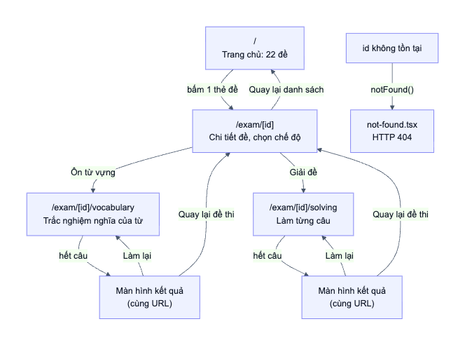
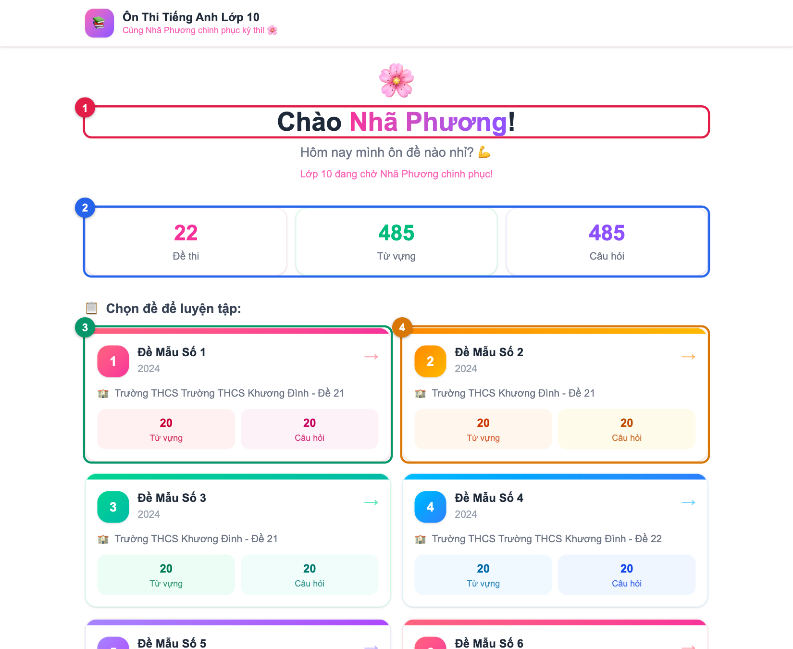
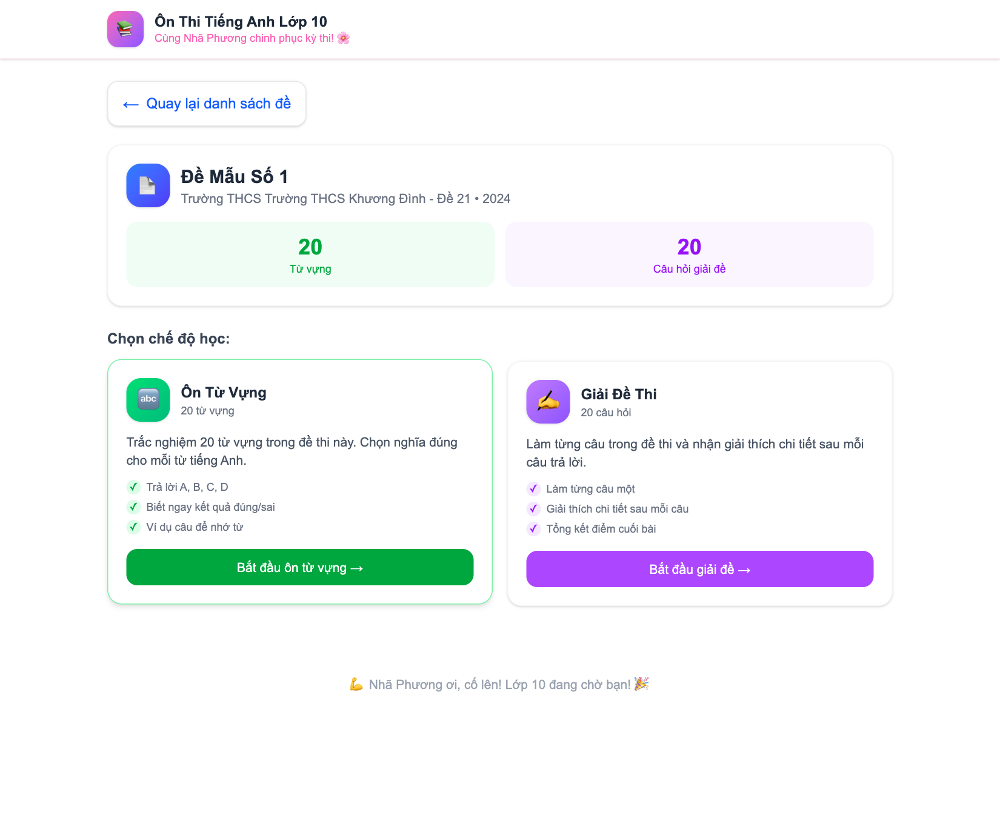
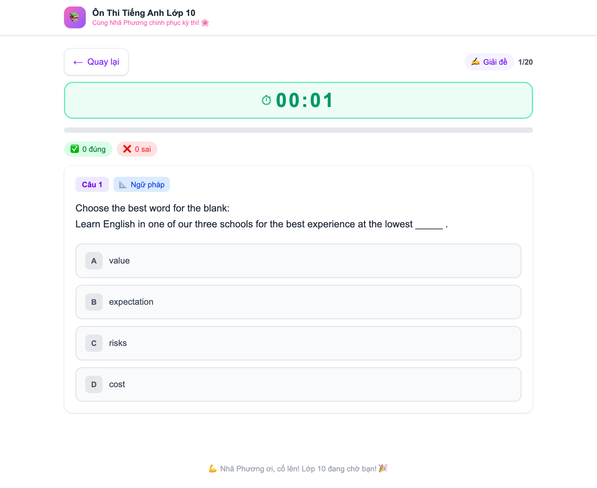
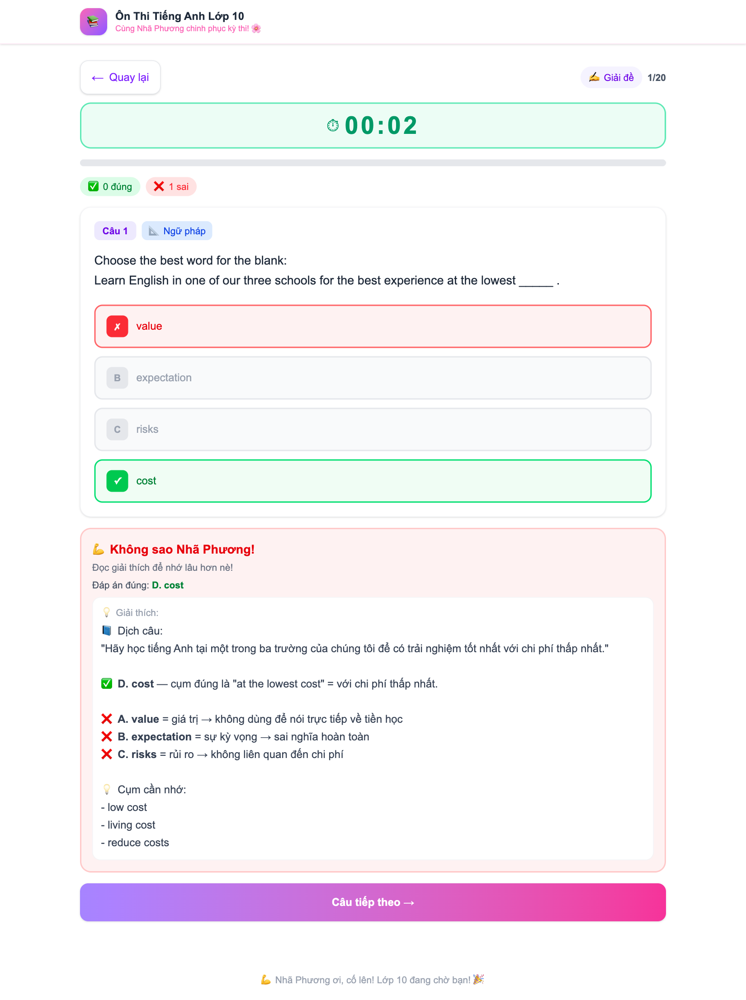
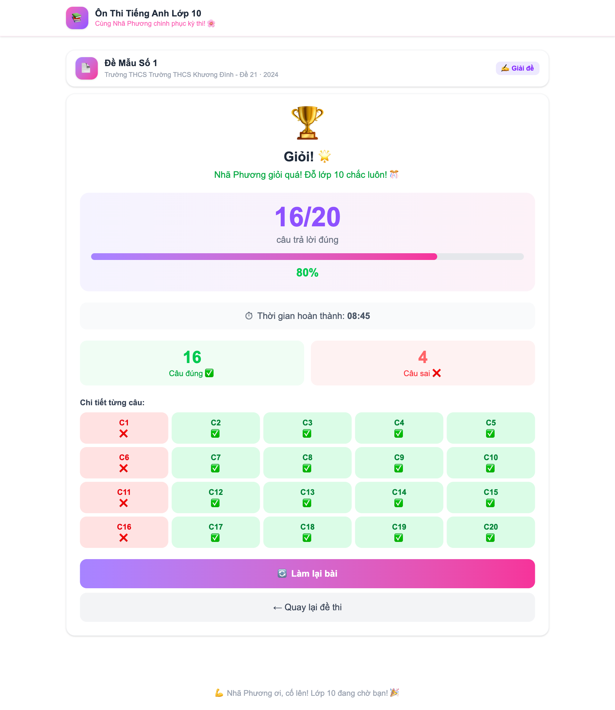
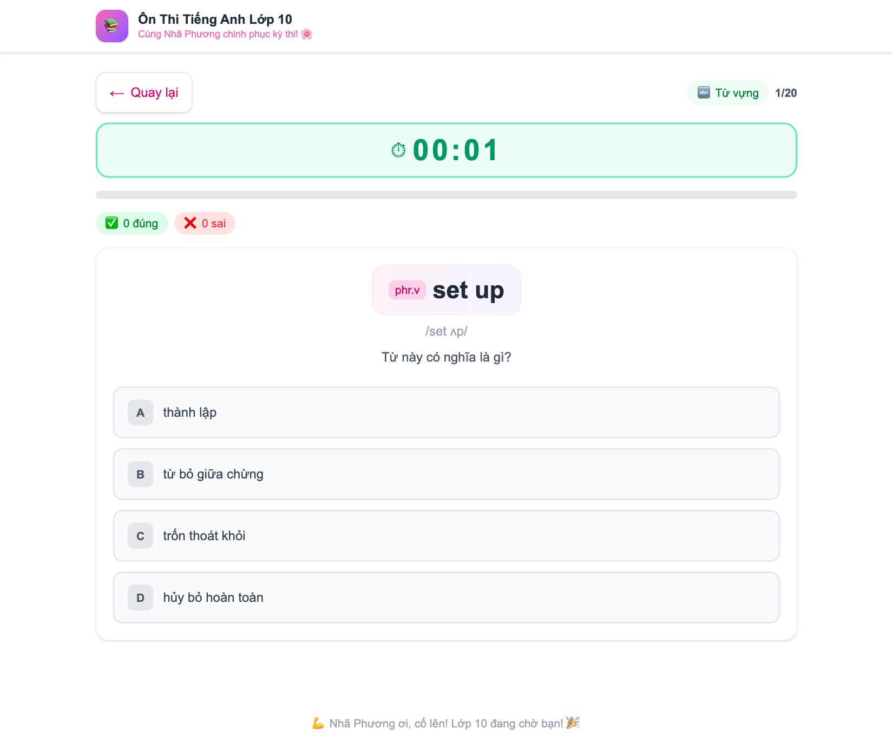
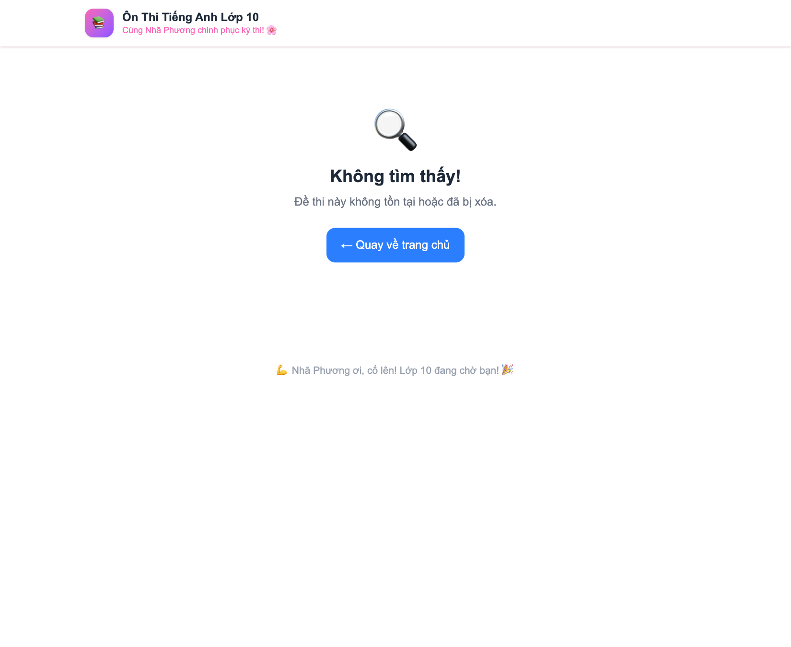
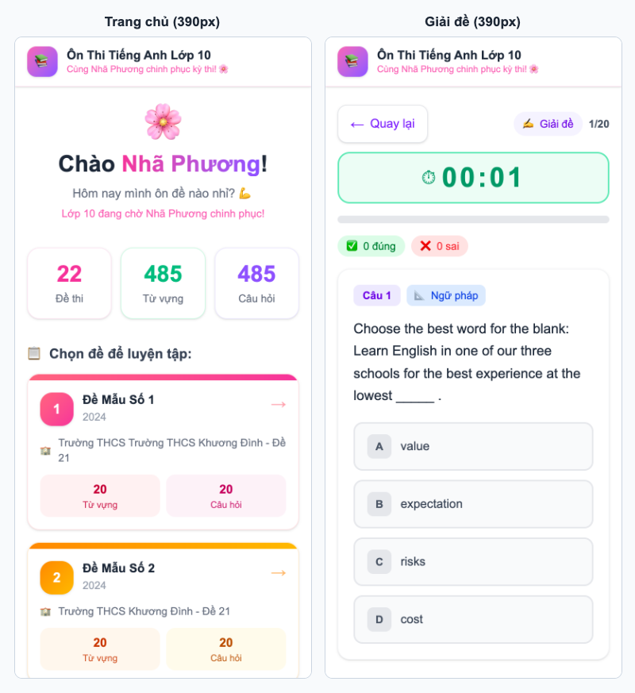
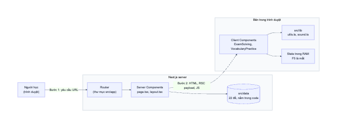

# 01. Tổng quan dự án

> **Đọc xong file này, bạn trả lời được:** App làm gì? Có những màn hình nào? Dùng công nghệ gì? Code nằm ở đâu? Dự án này *không có* những gì?
>
> **Thời gian:** khoảng 20 phút. Chưa cần đọc code.

## 1. App này là gì?

Đây là web app giúp một học sinh tên **Nhã Phương** ôn thi tiếng Anh vào lớp 10. Mỗi đề thi có hai chế độ học:

- **Ôn từ vựng:** cho một từ tiếng Anh, chọn nghĩa tiếng Việt đúng.
- **Giải đề:** làm từng câu trắc nghiệm, xem giải thích ngay sau mỗi câu.

Hiện có **22 đề, 485 từ vựng và 485 câu hỏi**. Toàn bộ nội dung nằm ngay trong source code, không có database.

## 2. Tham quan giao diện

Toàn bộ ảnh trong tài liệu được chụp từ app thật. Hãy mở app song song để bấm thử: chạy `npm run dev` rồi vào <http://localhost:3000>.

### 2.1. Sơ đồ các màn hình



Điểm cần chú ý: **màn hình kết quả không có URL riêng**. Nó vẫn ở `/exam/[id]/solving`, chỉ khác là state `isFinished` đã thành `true`. "Màn hình" và "URL" là hai khái niệm khác nhau, file 07 sẽ giải thích kỹ.

### 2.2. Trang chủ: `/`



| Số | Phần tử | Lấy dữ liệu từ đâu |
|----|---------|-------------------|
| 1 | Lời chào | Viết cứng trong code |
| 2 | Ba ô thống kê | Tính từ mảng `exams` bằng `reduce` |
| 3, 4 | Thẻ đề thi | `exams.map(...)`, màu xoay vòng theo `cardThemes` |

Trang này **không có state nào**: nó chỉ hiển thị dữ liệu, còn bấm thẻ chỉ là đi theo một đường link.

### 2.3. Chi tiết đề: `/exam/de-mau-01`

Trang này là ngã ba để chọn chế độ học.



### 2.4. Giải đề: `/exam/de-mau-01/solving`

Đây là màn hình "có nhiều logic" nhất. Trước khi trả lời, các nút ở trạng thái trung tính:



Sau khi chọn, app tô màu đáp án, phát âm thanh, hiện lời động viên và giải thích:



Làm hết câu thì hiện màn hình kết quả, **vẫn cùng URL**:



### 2.5. Ôn từ vựng: `/exam/de-mau-01/vocabulary`

Bố cục gần giống giải đề, nhưng thứ tự từ và thứ tự đáp án được **xáo ngẫu nhiên mỗi lần vào trang**. Chi tiết nhỏ này quyết định nơi đặt code: việc xáo phải nằm trên server, xem file 08.



### 2.6. Trang 404

Hiện khi URL sai hoặc `id` đề không tồn tại, ví dụ `/exam/khong-ton-tai`.



### 2.7. Trên điện thoại

Cùng một code, nhưng bố cục tự co lại nhờ các class responsive của Tailwind (file 09).



## 3. Công nghệ sử dụng

| Công nghệ | Phiên bản cài đặt | Vai trò trong dự án |
|-----------|-------------------|---------------------|
| **React** | 19.2.4 | Xây giao diện bằng component, state, effect |
| **Next.js** | 16.2.6 (App Router) | Routing theo thư mục, render trên server, đóng gói code |
| **TypeScript** | 5.9.3 | Mô tả hình dạng dữ liệu, bắt lỗi trước khi chạy |
| **Tailwind CSS** | 4.3.0 | Viết style bằng class ngay trong JSX |
| **clsx** | 2.1.1 | Ghép chuỗi class theo điều kiện |
| **Web Audio API** | Có sẵn trong trình duyệt | Tạo âm thanh đúng/sai mà không cần file nhạc |

> **Vì sao phải quan tâm đến Next.js khi đã học React?**
> React chỉ lo phần giao diện. Một app thật còn cần: URL nào hiện trang nào, HTML được tạo ở đâu, code được đóng gói thế nào. Next.js là framework lo những việc đó. Bạn sẽ thấy React "thuần" ở file 07 và 08, còn phần Next.js nằm ở file 04 và 05.

## 4. Kiến trúc trong một hình



Có thể tóm tắt dự án trong ba câu:

1. **Dữ liệu** là các object TypeScript nằm trong code và chỉ được đọc trên server.
2. **Server Components** nhận URL, tìm đúng đề, rồi trả về giao diện.
3. **Client Components** nhận đề thi qua prop, chạy trong trình duyệt và giữ toàn bộ trạng thái làm bài.

## 5. Bản đồ thư mục

```text
learning-english-web/
├── docs/                         Tài liệu bạn đang đọc
├── public/                       File tĩnh (hiện các SVG mẫu chưa được dùng)
├── src/
│   ├── app/                      ROUTING: cấu trúc thư mục = cấu trúc URL
│   │   ├── layout.tsx            Khung chung: header, footer
│   │   ├── page.tsx              URL /
│   │   ├── not-found.tsx         Trang 404
│   │   ├── globals.css           CSS toàn cục
│   │   └── exam/[id]/
│   │       ├── page.tsx          URL /exam/:id
│   │       ├── solving/page.tsx  URL /exam/:id/solving
│   │       └── vocabulary/page.tsx  URL /exam/:id/vocabulary
│   ├── components/               Component tương tác (Client Components)
│   │   ├── ExamSolving.tsx       415 dòng: toàn bộ logic giải đề
│   │   └── VocabularyPractice.tsx 355 dòng: toàn bộ logic ôn từ vựng
│   ├── data/
│   │   ├── exams.ts              Gom tất cả đề thành một mảng
│   │   └── exams/de-mau-XX.ts    22 file nội dung, khoảng 11.700 dòng
│   ├── lib/
│   │   ├── utils.ts              Xáo mảng, tính điểm, xếp loại, ghép class
│   │   └── sound.ts              Tạo âm thanh đúng/sai
│   └── types/index.ts            Định nghĩa kiểu dữ liệu
├── next.config.js                Cấu hình Next.js
├── tsconfig.json                 Cấu hình TypeScript
├── postcss.config.mjs            Nối Tailwind vào quy trình build
├── eslint.config.mjs             Quy tắc kiểm tra code
└── package.json                  Thư viện và lệnh chạy
```

**Tỷ lệ đáng chú ý:** phần logic và giao diện chỉ khoảng 1.500 dòng, còn dữ liệu chiếm gần 12.000 dòng. Đừng để con số tổng làm bạn nản: phần cần hiểu thật kỹ chỉ tập trung ở hai file trong `components/`.

## 6. Dự án này KHÔNG có gì?

Biết thứ gì không có cũng quan trọng như biết thứ gì có, vì nó giúp bạn khỏi đi tìm thứ không tồn tại.

| Không có | Hệ quả thực tế |
|----------|----------------|
| Database, API backend | Muốn thêm đề phải sửa code rồi deploy lại |
| Đăng nhập, tài khoản | Ai vào cũng thấy lời chào gửi Nhã Phương |
| `localStorage` hay lưu tiến độ | **F5 là mất** toàn bộ tiến độ đang làm |
| Redux, Zustand, Context | State nằm gọn trong từng component bằng `useState` |
| Thư viện gọi API (`fetch`, React Query) | Dữ liệu được `import` trực tiếp |
| Test tự động | Sửa code xong phải tự bấm thử |

Vì vậy đây là dự án **rất phù hợp để học nền tảng**: ít tầng trung gian, bạn nhìn thẳng vào cách React và Next.js vận hành.

## 7. Tự kiểm tra

1. Màn hình kết quả có URL riêng không? Vì sao?
2. Dữ liệu đề thi được lấy qua API hay cách nào khác?
3. Điều gì xảy ra khi bạn nhấn F5 ở câu 10?

<details>
<summary>Đáp án</summary>

1. Không. Nó vẫn ở `/exam/[id]/solving`; component chọn giao diện để hiển thị dựa trên state `isFinished`.
2. Không có API. Server Component `import` trực tiếp từ `src/data/exams.ts`.
3. Trang tải lại, component mount lại từ đầu, state về giá trị ban đầu, nên bạn quay về câu 1 và đồng hồ về 00:00.

</details>

**Tiếp theo:** [02. Lộ trình học](02-lo-trinh-hoc.md)
