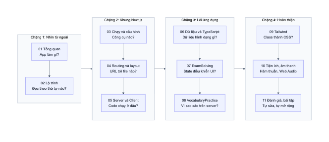

# 02. Lộ trình học

> **Mục tiêu của bộ tài liệu:** không chỉ biết "code này làm gì" mà hiểu "vì sao phải viết như vậy", để lần sau đọc dự án khác bạn nhanh hơn.

## 1. Đường đi

Thứ tự này đi **từ ngoài vào trong**: thấy sản phẩm trước, sau đó đến công cụ, khung framework, dữ liệu, rồi mới vào logic. Đây cũng là thứ tự nên dùng khi đọc bất kỳ dự án nào.

## 2. Nội dung từng file

Thời gian dưới đây chỉ là ước lượng, đã bao gồm việc mở code và thử theo hướng dẫn.

| File | Câu hỏi cốt lõi | Khái niệm chính | Thời gian |
|------|-----------------|-----------------|-----------|
| [01. Tổng quan](01-tong-quan-du-an.md) | App làm gì? | Giao diện, công nghệ, bản đồ thư mục | 20 phút |
| [03. Chạy và cấu hình](03-chay-du-an-va-cau-hinh.md) | Có những công cụ nào? | npm scripts, tsconfig, alias `@/` | 30 phút |
| [04. Routing và layout](04-routing-va-layout.md) | URL đi tới file nào? | App Router, `[id]`, layout, `Link` | 45 phút |
| [05. Server và Client](05-server-va-client-components.md) | Code chạy ở đâu? | SSR, RSC payload, hydration | 90 phút |
| [06. Dữ liệu và TypeScript](06-du-lieu-va-typescript.md) | Dữ liệu có hình dạng gì? | `interface`, optional, luồng prop | 40 phút |
| [07. ExamSolving](07-exam-solving.md) | State điều khiển UI ra sao? | State, derived state, effect, ref | 120 phút |
| [08. VocabularyPractice](08-vocabulary-practice.md) | Vì sao xáo câu hỏi trên server? | Hydration mismatch, Strict Mode | 60 phút |
| [09. Tailwind và giao diện](09-tailwind-va-giao-dien.md) | Class biến thành CSS thế nào? | Utility class, responsive, cascade layer | 45 phút |
| [10. Tiện ích và âm thanh](10-tien-ich-va-am-thanh.md) | Hàm thuần là gì? | Fisher-Yates, generic, Web Audio | 40 phút |
| [11. Đánh giá và bài tập](11-danh-gia-va-bai-tap.md) | Tự làm được chưa? | Nợ kỹ thuật, bài tập, cách đọc dự án mới | Tuỳ bạn |

**Nếu chỉ có ít thời gian**, hãy ưu tiên **05 và 07**. Hai file này chứa phần bản chất nhất của dự án.

## 3. Lý thuyết React bạn đã học nằm ở đâu trong dự án?

Dùng bảng này để nối kiến thức đã có với code thật.

| Khái niệm | Vị trí trong dự án | Giải thích tại |
|-----------|--------------------|----------------|
| Component, props | `ExamSolving({ exam })` | 06, 07 |
| JSX, render danh sách | `exams.map(...)` trong trang chủ | 04 |
| Conditional rendering | `if (isFinished) return ...` | 07 |
| `useState` | `currentIndex`, `results`, `elapsed` | 07 |
| Cập nhật dạng hàm | `setResults((prev) => [...prev, x])` | 07 |
| Derived state | `correctCount`, `lastResult` | 07 |
| `useEffect` và cleanup | Bộ đếm giờ với `setInterval` | 07 |
| `useRef` lưu giá trị | `startTimeRef`, `timerRef` | 07 |
| `useRef` trỏ tới DOM | `feedbackRef`, `scrollIntoView` | 07 |
| Event handler | `handleSelectAnswer`, `handleNext` | 07 |
| `key` và reconciliation | Câu hỏi mới không chạy lại animation | 07 |
| Rules of Hooks | Hook phải đứng trước mọi `return` sớm | 08 |
| Strict Mode | Effect chạy hai lần ở môi trường dev | 08 |

Những thứ **mới so với React thuần**, nên có thể chưa gặp khi học lý thuyết:

| Khái niệm mới | Giải thích tại |
|---------------|----------------|
| Routing theo thư mục | 04 |
| `async` component và `await params` | 04 |
| Server Component, `'use client'` | 05 |
| RSC payload, hydration | 05 |
| Hydration mismatch | 08 |

## 4. Cách học để hiểu sâu

Mỗi file nên đọc theo bốn bước:

1. **Đọc câu hỏi cốt lõi** ở đầu file, rồi tự đoán câu trả lời trước.
2. **Đọc song song với code.** Mọi link trong tài liệu đều mở được file nguồn, hãy bấm vào.
3. **Làm phần "Thử ngay".** Sửa code, xem chuyện gì xảy ra, rồi hoàn tác bằng `git checkout -- <file>` hoặc `Ctrl+Z`. Làm hỏng có chủ đích là cách hiểu nhanh nhất.
4. **Làm phần "Tự kiểm tra"** mà không nhìn đáp án. Nói được câu trả lời thành lời nghĩa là bạn đã hiểu thật.

**Công cụ nên dùng khi học:**

- **DevTools > Network** để xem trình duyệt tải những gì.
- **DevTools > Elements** để xem DOM đổi ra sao khi bấm.
- **DevTools > Sources** để đặt breakpoint trong `handleSelectAnswer`.
- **Tiện ích React Developer Tools** để xem state thay đổi theo thời gian thực.

## 5. Về độ tin cậy của tài liệu

- Các con số và hành vi đều được **đo trên code thật** với production build của code hiện tại. Nơi nào là kết quả đo, tài liệu ghi rõ là đã đo hoặc đã thử.
- Số dòng trong link có thể lệch khi code thay đổi. Khi đó hãy tìm theo tên hàm.
- `README.md` ở gốc dự án đã **cũ một phần**, ví dụ vẫn hướng dẫn thêm đề thẳng vào `exams.ts`. Khi có khác biệt, hãy tin code và file 06 của bộ tài liệu này.

**Tiếp theo:** [03. Chạy dự án và cấu hình](03-chay-du-an-va-cau-hinh.md)
