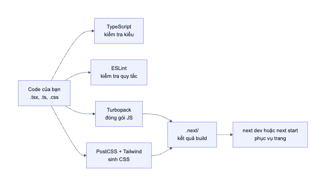

# 03. Chạy dự án và cấu hình

> **Câu hỏi cốt lõi:** Từ lúc gõ `npm run dev` đến lúc thấy trang web, những công cụ nào tham gia, và mỗi file cấu hình để làm gì?

## 1. Chạy thử

```bash
npm install      # Cài thư viện vào node_modules (chỉ cần lần đầu)
npm run dev      # Chạy server phát triển tại http://localhost:3000
```

Các lệnh được khai báo trong [package.json](../package.json):

| Lệnh | Thực chất chạy | Khi nào dùng |
|------|----------------|--------------|
| `npm run dev` | `next dev` | Khi đang viết code: tự cập nhật khi lưu file |
| `npm run build` | `next build` | Tạo bản tối ưu để triển khai |
| `npm start` | `next start` | Chạy bản đã build, phải `build` trước |
| `npm run lint` | `eslint` | Kiểm tra quy tắc code |

> **`dev` khác `build` như thế nào?**
> `dev` ưu tiên phản hồi nhanh và báo lỗi chi tiết, kèm các kiểm tra chỉ có ở dev như Strict Mode. `build` ưu tiên tốc độ cho người dùng: nén code, render sẵn trang tĩnh. Vì vậy có lỗi chỉ xuất hiện ở một trong hai môi trường.

## 2. Các công cụ phối hợp ra sao



| Công cụ | Làm gì | File cấu hình |
|---------|--------|---------------|
| TypeScript | Kiểm tra kiểu, không chạy code | `tsconfig.json` |
| ESLint | Kiểm tra quy tắc, bao gồm luật của React Hooks | `eslint.config.mjs` |
| Turbopack | Đóng gói JS (được tích hợp trong Next.js 16) | `next.config.js` |
| PostCSS + Tailwind | Sinh ra file CSS | `postcss.config.mjs` |

## 3. Đọc từng file cấu hình

### 3.1. `package.json`: dự án cần gì

```json
"dependencies": {
  "clsx": "^2.1.1",
  "lucide-react": "^1.16.0",
  "next": "^16.2.6",
  "react": "19.2.4",
  "react-dom": "19.2.4"
}
```

- **`dependencies`:** thư viện cần khi app chạy.
- **`devDependencies`:** chỉ cần lúc phát triển và build, như TypeScript, ESLint, Tailwind.
- **`^2.1.1`:** cho phép tự nâng lên bản mới hơn trong cùng major version, tức `2.x.x`. **`19.2.4`** không có dấu `^` nên được khoá cứng.
- **`package-lock.json`:** ghi chính xác phiên bản đã cài, để máy nào cài cũng giống nhau. Luôn commit file này.

> **Một phát hiện nhỏ:** `lucide-react` được khai báo nhưng không file nào trong `src/` import. Đây là thư viện thừa.

### 3.2. `tsconfig.json`: alias `@/`

Phần đáng chú ý nhất:

```json
"strict": true,
"noEmit": true,
"paths": { "@/*": ["./src/*"] }
```

- **`strict: true`:** bật toàn bộ kiểm tra nghiêm ngặt, ví dụ không thể quên xử lý `undefined`.
- **`noEmit: true`:** TypeScript chỉ kiểm tra và không tự xuất file JS, việc biên dịch đã có Next.js lo.
- **`paths`:** cho phép viết đường dẫn gọn từ `src`:

```ts
import { getExamById } from '@/data/exams';        // Dự án đang dùng
import { getExamById } from '../../../data/exams'; // Nếu không có alias
```

File có alias thì không phụ thuộc vị trí của nó trong cây thư mục, nên di chuyển file sẽ ít phải sửa hơn.

### 3.3. `next.config.js`: cấu hình Next.js

[File này](../next.config.js) chỉ có một dòng cấu hình thật sự:

```js
allowedDevOrigins: ['192.168.*.*'],
```

Dòng này cho phép mở server dev qua IP mạng LAN, ví dụ từ điện thoại. Nếu thiếu nó, trang vẫn hiện nhưng bấm không có tác dụng. Đây là một lỗi rất đáng học và được phân tích ở [file 05](05-server-va-client-components.md#7-tình-huống-thực-tế-lỗi-mở-qua-ip-lan).

### 3.4. `postcss.config.mjs`: nối Tailwind vào build

```js
plugins: { "@tailwindcss/postcss": {} }
```

Không có dòng này thì `@import "tailwindcss"` trong CSS sẽ không được xử lý. Xem thêm file 09.

### 3.5. `eslint.config.mjs`: quy tắc code

File này dùng bộ quy tắc có sẵn của Next.js (`core-web-vitals`, `typescript`). Bộ quy tắc bao gồm các luật về React Hooks.

### 3.6. Các file tự sinh

| File / thư mục | Là gì | Có commit? |
|----------------|-------|-----------|
| `node_modules/` | Thư viện đã cài | Không |
| `.next/` | Kết quả build | Không |
| `next-env.d.ts` | Khai báo kiểu cho Next.js, tự sinh | Không |
| `tsconfig.tsbuildinfo` | Cache của TypeScript | Không |

Danh sách này được khai báo trong [.gitignore](../.gitignore).

## 4. Kết quả kiểm tra hiện tại

Đây là kết quả chạy thật trên commit `3525d20`:

| Lệnh | Kết quả |
|------|---------|
| `npx tsc --noEmit` | Sạch, không có lỗi |
| `npx next build` | Thành công |
| `npx eslint src` | **4 lỗi**, phân tích ở file 11 |

**Điều rút ra:** `next build` vẫn thành công dù ESLint báo 4 lỗi. Trong lần chạy này, build không hề chạy ESLint. Do đó "build được" chưa có nghĩa là "code sạch"; bạn phải tự chạy `npm run lint`.

Bảng route do build in ra cũng rất đáng xem, file 05 sẽ giải thích ý nghĩa:

```text
Route (app)
┌ ○ /
├ ○ /_not-found
├ ƒ /exam/[id]
├ ƒ /exam/[id]/solving
└ ƒ /exam/[id]/vocabulary

○  (Static)   prerendered as static content
ƒ  (Dynamic)  server-rendered on demand
```

## 5. Thử ngay

1. Chạy `npm run lint` và đọc 4 lỗi. Chưa cần hiểu hết.
2. Trong [src/app/page.tsx](../src/app/page.tsx), đổi `exam.title` thành `exam.titel` rồi chạy `npx tsc --noEmit`. Xem TypeScript báo gì, sau đó hoàn tác.
3. Đổi `@/data/exams` thành `@/data/exam` để xem thông báo lỗi khi không tìm thấy module, sau đó hoàn tác.

## 6. Tự kiểm tra

1. Vì sao `react` không có dấu `^` còn `next` thì có? Khác nhau ở điểm nào?
2. `@/lib/utils` trỏ tới file nào? Ai quy định điều đó?
3. Build thành công có đảm bảo ESLint sạch không?

<details>
<summary>Đáp án</summary>

1. `19.2.4` khoá đúng phiên bản; `^16.2.6` cho phép cài bản mới hơn trong dòng 16.x.x. Bản được cài thực tế được ghi trong `package-lock.json`.
2. `src/lib/utils.ts`, do `paths` trong `tsconfig.json` quy định.
3. Không. Dự án này build thành công dù ESLint báo 4 lỗi.

</details>

**Tiếp theo:** [04. Routing và layout](04-routing-va-layout.md)
