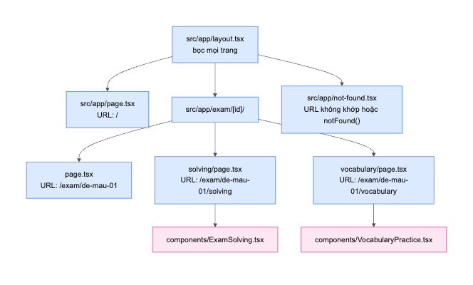
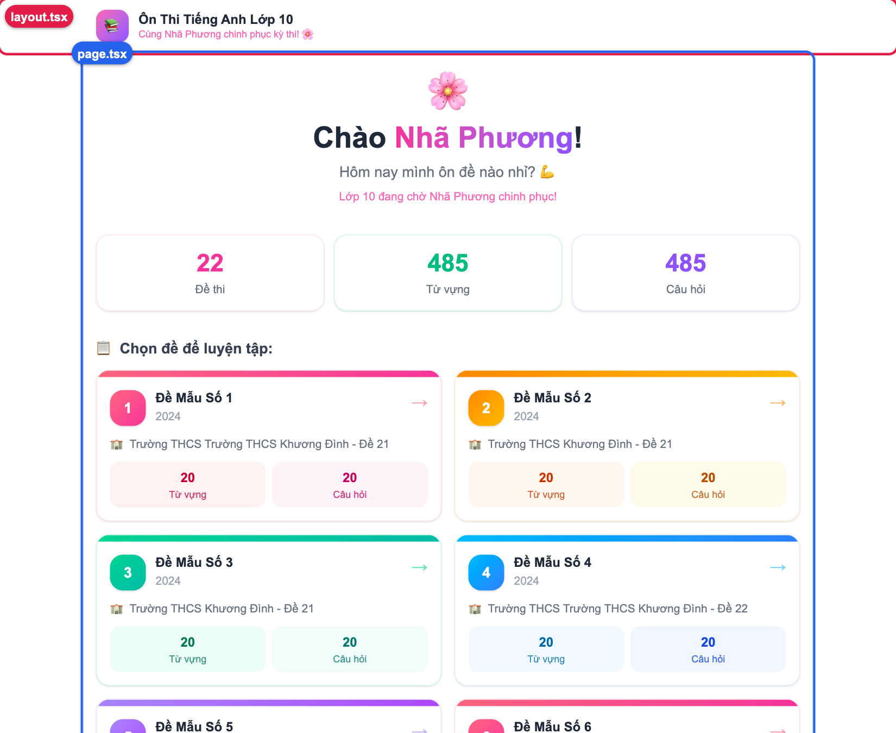

# 04. Routing và layout

> **Câu hỏi cốt lõi:** Khi người dùng vào một URL, Next.js chọn file nào để hiển thị, và khung chung được áp dụng thế nào?

## 1. Ý tưởng chính: thư mục chính là URL

Với React thuần, bạn phải tự cấu hình route, ví dụ bằng React Router. Trong Next.js App Router, **cấu trúc thư mục trong `src/app` chính là cấu trúc URL**.

Quy tắc cần nhớ: chỉ file tên **`page.tsx`** mới tạo ra một trang truy cập được.



*Màu xanh là Server Component, màu hồng là Client Component. File 05 sẽ giải thích sự khác biệt này.*

| URL | File xử lý |
|-----|-----------|
| `/` | [src/app/page.tsx](../src/app/page.tsx) |
| `/exam/de-mau-01` | [src/app/exam/[id]/page.tsx](../src/app/exam/[id]/page.tsx) |
| `/exam/de-mau-01/solving` | [src/app/exam/[id]/solving/page.tsx](../src/app/exam/[id]/solving/page.tsx) |
| `/exam/de-mau-01/vocabulary` | [src/app/exam/[id]/vocabulary/page.tsx](../src/app/exam/[id]/vocabulary/page.tsx) |
| URL không tồn tại | [src/app/not-found.tsx](../src/app/not-found.tsx) |

### Tên file có ý nghĩa đặc biệt

| Tên file | Vai trò | Dự án có dùng? |
|----------|---------|----------------|
| `page.tsx` | Giao diện của một URL | Có |
| `layout.tsx` | Khung bọc các trang con | Có |
| `not-found.tsx` | Giao diện 404 | Có |
| `loading.tsx` | Giao diện chờ khi trang đang tải | Không |
| `error.tsx` | Giao diện khi có lỗi runtime | Không |

Vì thế `components/ExamSolving.tsx` không tự tạo URL nào: nó nằm ngoài `app` và không phải `page.tsx`.

## 2. Dynamic route: thư mục `[id]`

Có 22 đề, nhưng không cần 22 thư mục. Dấu ngoặc vuông nghĩa là "đoạn này của URL là một biến":

```text
URL:  /exam/de-mau-01/solving
             └── id = 'de-mau-01'
```

Trang đọc giá trị đó qua prop `params`. Đây là [toàn bộ trang giải đề](../src/app/exam/[id]/solving/page.tsx):

```tsx
interface Props {
  params: Promise<{ id: string }>;
}

export default async function SolvingPage({ params }: Props) {
  const { id } = await params;       // 1. Lấy id từ URL
  const exam = getExamById(id);      // 2. Tìm đề thi

  if (!exam) {
    notFound();                      // 3. Không có thì hiện trang 404
  }

  return <ExamSolving exam={exam} />; // 4. Giao cho Client Component
}
```

Trong đoạn code ngắn này có **ba điểm có thể khác với những gì bạn đã học**:

### Điểm 1: component có thể là `async`

Với React phía client, component không được phép là hàm `async`. Riêng **Server Component thì được**: server có thể chờ dữ liệu xong rồi mới trả kết quả.

### Điểm 2: `params` là một `Promise`

Ở các tài liệu Next.js cũ, bạn có thể thấy `params.id` được đọc trực tiếp. Ở Next.js 16, `params` là Promise nên **bắt buộc phải `await`**. Đây là một trong những lý do [AGENTS.md](../AGENTS.md) nhắc phải đọc tài liệu đúng phiên bản trong `node_modules/next/dist/docs/`.

### Điểm 3: `notFound()` giúp TypeScript hiểu luồng code

`getExamById` trả về `Exam | undefined`, nhưng ở dòng cuối TypeScript vẫn chấp nhận `exam` là `Exam`. Lý do: kiểu trả về của `notFound()` là `never`, nghĩa là "hàm này không bao giờ chạy xong bình thường". TypeScript suy ra rằng nếu chạy tới được dòng cuối thì `exam` chắc chắn tồn tại.

**Đã thử:** `/exam/khong-ton-tai` trả về HTTP **404** thật, không chỉ hiện giao diện báo lỗi. Điều này quan trọng với công cụ tìm kiếm.

## 3. Layout: khung dùng chung

[layout.tsx](../src/app/layout.tsx) bọc tất cả các trang. Phần header, footer và `<main>` chỉ viết một lần:

```tsx
export default function RootLayout({ children }) {
  return (
    <html lang="vi">
      <body>
        <header>...</header>
        <main className="max-w-4xl mx-auto px-4 py-6">
          {children}   {/* page.tsx của URL hiện tại được đặt vào đây */}
        </main>
        <footer>...</footer>
      </body>
    </html>
  );
}
```



- **Root layout bắt buộc có thẻ `<html>` và `<body>`.** Trong app React thuần, các thẻ này thường nằm ở `index.html`.
- **`children` chính là composition của React.** Next.js tự truyền `page.tsx` vào đó.
- **Layout được giữ nguyên khi chuyển trang.** Khi điều hướng, Next.js chỉ thay phần `children`, nên header không bị render lại.

### `metadata`

```tsx
export const metadata: Metadata = {
  title: 'Ôn Thi Tiếng Anh — Nhã Phương',
  description: 'App ôn thi tiếng Anh vào lớp 10 của Nhã Phương',
};
```

Next.js đọc export có tên đặc biệt này để sinh thẻ `<title>` và `<meta>` trong HTML. Bạn không cần tự viết thẻ `<head>`.

## 4. Điều hướng bằng `<Link>`

```tsx
import Link from 'next/link';

<Link href={`/exam/${exam.id}`}>...</Link>
```

Kết quả HTML vẫn là thẻ `<a>`, nhưng khi JavaScript đang chạy thì `Link` chặn việc tải lại trang và tự đổi nội dung.

**Đã đo** bằng cách bấm từ trang chủ vào một đề:

| Chỉ số | Kết quả | Ý nghĩa |
|--------|---------|---------|
| Số request loại `document` | **0** | Trình duyệt không tải lại trang |
| Biến gắn tạm vào `window` trước khi bấm | **Vẫn còn** | Môi trường JS không bị khởi tạo lại |
| Có request `?_rsc=...` | **Có** | Chỉ lấy dữ liệu của trang mới |

Nếu tắt JavaScript, `Link` vẫn hoạt động như thẻ `<a>` thường và URL vẫn đổi đúng. Đó là lợi ích của việc dùng thẻ `<a>` thật thay vì `<div onClick>`.

> **Prefetch:** `Link` có thể tải trước trang đích khi link xuất hiện trong khung nhìn. Lần đo trên production ghi nhận **19 request `_rsc`** ngay khi mở trang chủ, trước khi bấm gì. Bạn có thể tự xem trong tab Network.

## 5. Đọc code trang chủ

[src/app/page.tsx](../src/app/page.tsx) là ví dụ rất tốt cho React cơ bản, vì không có state:

```tsx
const totalVocab = exams.reduce((sum, e) => sum + e.vocabulary.length, 0);

{exams.map((exam, index) => {
  const theme = cardThemes[index % cardThemes.length];
  return (
    <Link key={exam.id} href={`/exam/${exam.id}`} className="block group">
      ...
    </Link>
  );
})}
```

- **`key={exam.id}`:** dùng `id` ổn định thay vì `index`, đúng theo khuyến nghị của React.
- **`index % cardThemes.length`:** có 5 bộ màu cho 22 đề, phép chia lấy dư giúp xoay vòng 0, 1, 2, 3, 4, 0...
- **`{exam.year && <span>...}`:** chỉ render khi có `year`, vì trường này là tuỳ chọn.

## 6. Thử ngay

1. Tạo `src/app/test/page.tsx` với `export default function P() { return <h1>Xin chào</h1>; }` rồi vào `/test`. Không cần cấu hình gì thêm. Xoá file sau khi thử.
2. Đổi tên file đó thành `hello.tsx`. Vào `/test` sẽ thấy 404, vì không còn `page.tsx`.
3. Vào `/exam/abc`, rồi xem tab Network để thấy mã trạng thái 404.
4. Mở tab Network, bấm thẻ đề, quan sát request `_rsc`, sau đó thử tải thẳng URL bằng F5 để thấy request loại `document`.

## 7. Tự kiểm tra

1. Vì sao `components/ExamSolving.tsx` không tạo ra URL?
2. Điều gì xảy ra nếu viết `const { id } = params;` mà thiếu `await`?
3. Khi chuyển từ trang chủ sang trang đề, phần nào được giữ lại?
4. Vì sao TypeScript không báo lỗi `exam` có thể là `undefined` ở dòng `<ExamSolving exam={exam} />`?

<details>
<summary>Đáp án</summary>

1. Nó nằm ngoài `src/app` và không tên là `page.tsx`.
2. `params` là Promise nên `id` sẽ là `undefined`, TypeScript cũng sẽ báo lỗi vì Promise không có thuộc tính `id`.
3. Root layout, gồm header và footer. Chỉ phần `children` được thay.
4. `notFound()` có kiểu trả về `never`. TypeScript hiểu nhánh `!exam` không chạy tiếp, nên sau khối `if` thì `exam` chỉ có thể là `Exam`.

</details>

**Tiếp theo:** [05. Server và Client Components](05-server-va-client-components.md)
