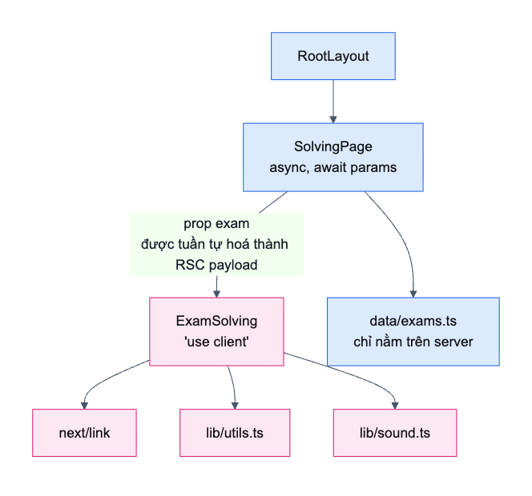
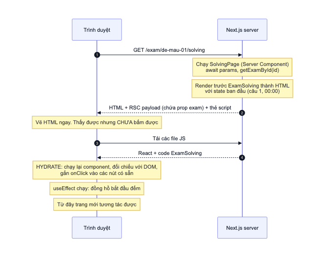
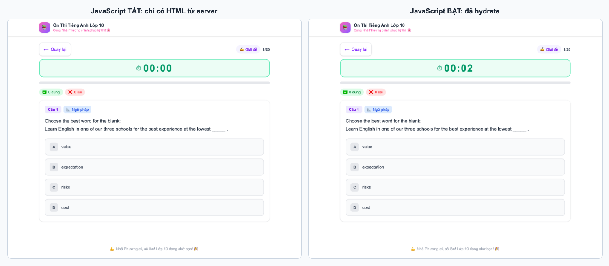
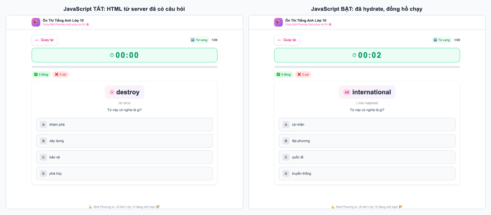
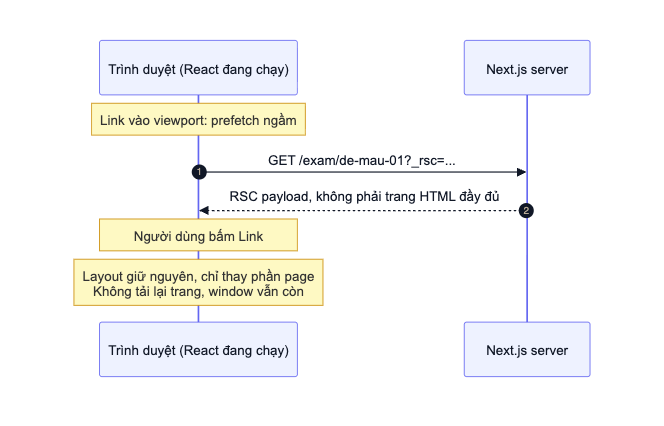

# 05. Server và Client Components

> **Câu hỏi cốt lõi:** Mỗi dòng code chạy trên máy nào, vào lúc nào? Vì sao có lúc trang hiện đầy đủ mà bấm không có tác dụng?
>
> Đây là file quan trọng nhất về Next.js. Hiểu file này, bạn sẽ giải thích được phần lớn các lỗi "lạ" khi làm việc với framework.

## 1. Đặt vấn đề: React thuần làm gì?

Với app React thuần (Vite, CRA), trình duyệt nhận một HTML gần như rỗng, tải JS rồi mới vẽ giao diện:

```html
<body><div id="root"></div><script src="bundle.js"></script></body>
```

Cách này có hai nhược điểm: người dùng nhìn màn hình trắng trong lúc chờ JS, và toàn bộ code cùng dữ liệu phải gửi xuống trình duyệt.

Next.js giải quyết bằng cách **chạy React trên server trước**, rồi mới tiếp tục trong trình duyệt.

## 2. Hai loại component

Trong App Router, **mọi component mặc định là Server Component**. Chỉ khi file có `'use client'` ở đầu thì nó mới là Client Component.

| | Server Component | Client Component |
|---|---|---|
| **Khai báo** | Mặc định | `'use client'` ở đầu file |
| **Trong dự án** | Mọi file trong `src/app` | `ExamSolving`, `VocabularyPractice` |
| **`useState`, `useEffect`** | Không dùng được | Dùng được |
| **`onClick`** | Không dùng được | Dùng được |
| **`window`, Web Audio** | Không có | Có, nhưng chỉ trong effect và handler |
| **`async` component** | Được | Không |
| **Code có gửi xuống trình duyệt?** | **Không** | **Có** |

> **Hiểu lầm phổ biến nhất:** "Client Component chỉ chạy ở trình duyệt". **Sai.** Ở lần tải trang đầu, Client Component **cũng chạy trên server một lần** để tạo HTML, sau đó chạy lại trong trình duyệt. Đó là lý do `ExamSolving` hiện ra ngay trong HTML, và cũng là gốc rễ của hydration mismatch ở file 08.

### Ranh giới trong dự án



`'use client'` đánh dấu một **ranh giới**, không chỉ một file: mọi module mà `ExamSolving` import đều được đưa vào bundle phía client.

Dự án này chia ranh giới rất gọn: trang chỉ làm đúng một việc là tìm dữ liệu, còn tương tác giao cho một component duy nhất.

## 3. Chuyện gì xảy ra khi tải trang lần đầu?



Có ba thứ được gửi xuống trình duyệt, mỗi thứ một nhiệm vụ:

| Thành phần | Nhiệm vụ |
|------------|----------|
| **HTML** | Hiển thị ngay, nhưng chưa bấm được |
| **RSC payload** | Bản mô tả cây component, gồm **các prop truyền từ server sang client** |
| **JavaScript** | Code của Client Components, dùng để hydrate |

### Hydration là gì?

Hydration là quá trình React **gắn các event handler vào HTML đã có sẵn**, thay vì tạo lại DOM từ đầu. Trước khi xong bước này, nút chỉ là HTML tĩnh: bạn thấy nhưng bấm không có tác dụng.

Hình dung: HTML là căn nhà đã xây xong nhưng chưa có điện. Hydration là bước đấu điện, và trông bề ngoài căn nhà không hề thay đổi.

### Bằng chứng: tắt JavaScript

Tôi đã mở cùng một trang trong hai điều kiện:



Hai bên gần như giống hệt nhau. Bên trái, chỉ có HTML từ server, đồng hồ đứng ở `00:00` và các nút không phản ứng. Điều này chứng minh rằng **`ExamSolving` đã được render trên server**, dù nó là Client Component. Còn `useEffect`, nơi khởi động đồng hồ, **chỉ chạy trong trình duyệt**.

Trang từ vựng cũng vậy. Câu hỏi ở đây được xáo ngẫu nhiên, nhưng việc xáo diễn ra trên server nên HTML đã có sẵn nội dung:



Hai bên hiện từ khác nhau vì đây là hai lần tải riêng, mỗi request được xáo một lần. File 08 giải thích vì sao việc xáo phải nằm trên server.

**Bạn tự làm được:** DevTools > `Cmd+Shift+P` > gõ `Disable JavaScript` > tải lại trang.

## 4. Điều hướng sau lần đầu khác gì?



Khi bấm `<Link>`, trình duyệt không cần HTML của cả trang. React đã chạy sẵn, chỉ cần RSC payload của trang mới. Client Components khi đó được render hoàn toàn trên client.

## 5. Dữ liệu đi đâu?

Đây là phần thể hiện rõ giá trị của Server Components. **Kết quả đo trên production build:**

| Kiểm tra | Kết quả |
|----------|---------|
| Tổng dung lượng dữ liệu 22 đề (dạng JSON) | khoảng 372 KB |
| Số file JS gửi xuống trình duyệt có chứa nội dung đề | **0** |
| File trên server có chứa nội dung đề | Có |

Như vậy **dù có 22 đề, trình duyệt không phải tải toàn bộ dữ liệu trong JS bundle**, vì chỉ Server Component mới `import` từ `@/data/exams`.

Vậy dữ liệu của một đề xuống trình duyệt bằng cách nào? Qua **prop**:

```tsx
return <ExamSolving exam={exam} />;
//                  ^^^^^^^^^^^ Được tuần tự hoá và nhúng vào RSC payload trong HTML
```

| Route | Loại | Kích thước HTML | Có chứa đáp án và dữ liệu đề? |
|-------|------|-----------------|-------------------------------|
| `/` | ○ Static | 93.852 byte | Không, chỉ có thông tin hiển thị |
| `/exam/de-mau-01` | ƒ Dynamic | 19.384 byte | Không |
| `/exam/de-mau-01/solving` | ƒ Dynamic | 35.314 byte | **Có** |
| `/exam/de-mau-01/vocabulary` | ƒ Dynamic | 44.127 byte | **Có**, từ vựng có mặt hai lần |
| `/exam/khong-ton-tai` | ƒ 404 | 7.726 byte | Không |

*Kích thước chưa nén. Trang chủ lớn vì có 22 thẻ với rất nhiều class Tailwind.*

Từ bảng này rút ra hai bài học thực tế:

1. **Đáp án nằm trong page source.** Ai biết xem nguồn trang đều đọc được `correctAnswer`. Với app ôn tập thì không sao, nhưng với **thi thật có tính điểm thì không được làm như vậy**. Mọi prop truyền xuống Client Component đều công khai.
2. **Đang truyền thừa dữ liệu.** Trang giải đề nhận cả `exam.vocabulary` dù không dùng. Trang từ vựng nhận cả `questions`, và danh sách từ vựng có mặt hai lần: trong `exam` và trong `initialQuestions` đã xáo (xem file 08). Có thể truyền ít hơn, đây là một bài tập ở file 11.

> **Quy tắc rút ra:** Prop truyền từ Server sang Client Component phải tuần tự hoá được, và **coi như công khai**. Không truyền mật khẩu hay API key qua đây.

## 6. Static và Dynamic

Ký hiệu `○` và `ƒ` trong bảng trên cho biết **khi nào** server render:

| | ○ Static | ƒ Dynamic |
|---|---|---|
| **Render lúc nào** | Một lần, lúc `next build` | Mỗi lần có request |
| **Trong dự án** | `/`, `/_not-found` | Các route `/exam/[id]...` |
| **Header đo được** | `x-nextjs-cache: HIT`, `s-maxage=31536000` | `private, no-cache, no-store` |

`/exam/[id]` là dynamic vì khi build, Next.js không biết sẽ có những `id` nào. Thực ra dữ liệu không hề thay đổi, nên có thể khai báo trước bằng `generateStaticParams` để render sẵn 66 trang (22 đề × 3 route). Đây cũng là một bài tập ở file 11.

## 7. Tình huống thực tế: lỗi mở qua IP LAN

Dự án từng gặp lỗi: mở bằng `localhost:3000` thì tốt, mở bằng `192.168.0.102:3000` thì trang hiện đủ nhưng bấm đáp án không có tác dụng.

Sau khi đọc phần trên, bạn đã có đủ khái niệm để chẩn đoán: **trang hiện được nhưng bấm không được chính là triệu chứng của việc chưa hydrate.**

**Kết quả đo khi mở bằng trình duyệt thật:**

| Kiểm tra | `localhost` | IP LAN, chưa sửa | IP LAN, đã sửa |
|----------|-------------|------------------|----------------|
| WebSocket `/_next/webpack-hmr` | Kết nối | **Bị từ chối, thử lại liên tục** | Kết nối |
| React đã hydrate | Có | **Không** | Có |
| Đồng hồ | Chạy | **Đứng ở `00:00`** | Chạy |
| Bấm đáp án | Có tác dụng | **Không** | Có tác dụng |

**Nguyên nhân:** vì lý do bảo mật, server dev của Next.js chặn các request tới tài nguyên dev đến từ host lạ. Mặc định chỉ `localhost` được phép. **Cách sửa** là khai báo thêm trong [next.config.js](../next.config.js):

```js
allowedDevOrigins: ['192.168.*.*'],
```

Lỗi này chỉ xảy ra với `next dev`, không xảy ra ở production.

**Kỹ năng rút ra:** khi gặp lỗi "trang đẹp nhưng bấm không được", hãy nghi ngờ hydration trước, rồi xem Console để tìm lỗi JS, và xem Network để tìm tài nguyên bị chặn.

## 8. Vì sao `sound.ts` kiểm tra `window`?

```ts
function getAudioContext(): AudioContext | null {
  if (typeof window === 'undefined') return null;
```

Trên server không có `window`. Vì `ExamSolving` cũng chạy trên server, mọi module nó import đều phải an toàn khi nạp ở đó. Nếu gọi `window.AudioContext` ngay ở cấp module, server sẽ lỗi.

Thực tế hàm này chỉ được gọi trong event handler, mà handler thì không chạy trên server. Vì thế kiểm tra trên chỉ là lớp bảo vệ thêm, không phải bắt buộc. Quy tắc tổng quát: **API trình duyệt chỉ nên gọi trong event handler hoặc `useEffect`**, vì hai nơi này chỉ chạy ở trình duyệt.

## 9. Thử ngay

1. Xoá `'use client'` trong `ExamSolving.tsx`. Đọc thông báo lỗi, sau đó hoàn tác.
2. Trong `SolvingPage`, thêm `console.log('server?')`. Log xuất hiện ở **terminal**, không ở Console trình duyệt.
3. Trong thân `ExamSolving`, thêm `console.log('client?')`, rồi F5. Log xuất hiện ở **cả terminal và Console**. Bạn vừa chứng minh Client Component chạy ở cả hai nơi.
4. Xem page source (`Cmd+Option+U`) của trang giải đề, rồi tìm chuỗi `correctAnswer`.

## 10. Tự kiểm tra

1. Client Component có chạy trên server không?
2. Hydration làm gì? Nó có tạo lại DOM không?
3. Vì sao 22 đề không làm JS bundle phình lên?
4. Vì sao không nên đặt API key vào prop của Client Component?
5. Vì sao `/` là Static còn `/exam/[id]` là Dynamic?

<details>
<summary>Đáp án</summary>

1. Có, ở lần tải trang đầu, để tạo HTML. Sau đó nó chạy lại trong trình duyệt.
2. Gắn event handler vào DOM đã có và đối chiếu với kết quả render ở client. Nó không tạo lại DOM, trừ khi có mismatch nghiêm trọng.
3. `data/exams` chỉ được Server Components import, nên không đi vào bundle của client. Dữ liệu chỉ xuống trình duyệt theo từng đề, qua prop.
4. Prop được nhúng vào RSC payload trong HTML, ai cũng đọc được.
5. `/` không phụ thuộc gì vào request nên render sẵn được lúc build. `/exam/[id]` phụ thuộc `params`, và dự án không khai báo `generateStaticParams`.

</details>

**Tiếp theo:** [06. Dữ liệu và TypeScript](06-du-lieu-va-typescript.md)
