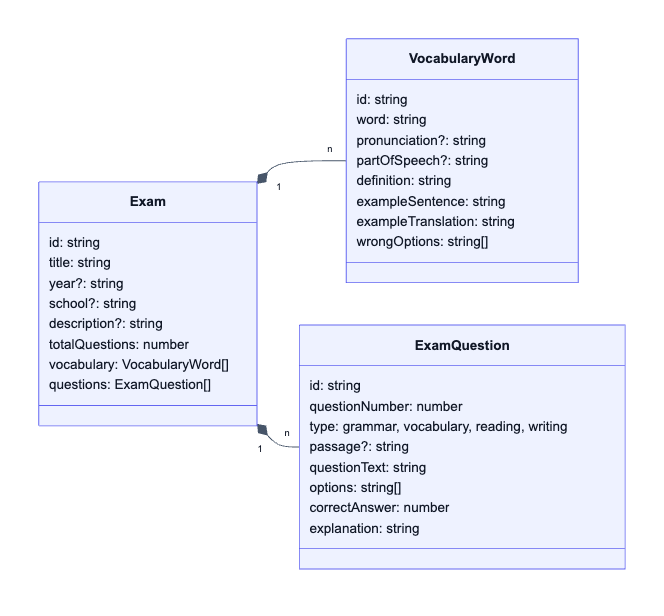
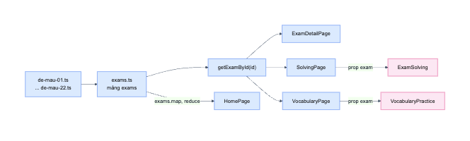

# 06. Dữ liệu và TypeScript

> **Câu hỏi cốt lõi:** Dữ liệu có hình dạng gì, được tổ chức ra sao, và đi từ file đến màn hình theo đường nào?
>
> **Lời khuyên khi đọc dự án lạ:** đọc kiểu dữ liệu trước khi đọc logic. Khi đã biết `Exam` có gì, code giao diện sẽ dễ đoán hơn nhiều.

## 1. Mô hình dữ liệu

Tất cả nằm trong [src/types/index.ts](../src/types/index.ts).



Một `Exam` chứa hai danh sách độc lập, ứng với hai chế độ học:

- `vocabulary` cung cấp dữ liệu cho `VocabularyPractice`.
- `questions` cung cấp dữ liệu cho `ExamSolving`.

### Các cú pháp TypeScript cần biết

```ts
export interface ExamQuestion {
  id: string;
  type: 'grammar' | 'vocabulary' | 'reading' | 'writing';
  passage?: string;
  options: string[];
  correctAnswer: number;
}
```

| Cú pháp | Ý nghĩa | Tác dụng thực tế |
|---------|---------|------------------|
| `interface` | Mô tả hình dạng object | Gõ sai tên trường là báo lỗi ngay |
| `passage?: string` | Trường tuỳ chọn, kiểu thực tế là `string \| undefined` | Bắt buộc phải kiểm tra trước khi dùng |
| `'grammar' \| 'reading'` | Union của các giá trị cụ thể | Gõ `'gramar'` sẽ báo lỗi |
| `string[]` | Mảng chuỗi | Dùng được `.map` với gợi ý kiểu |

Dấu `?` chính là lý do JSX phải viết như sau:

```tsx
{currentQuestion.passage && (
  <div>...{renderBoldText(currentQuestion.passage)}</div>
)}
```

`renderBoldText` yêu cầu `string`. Nhờ `&&`, TypeScript biết bên trong nhánh đó `passage` chắc chắn có giá trị.

### `correctAnswer` là vị trí, không phải nội dung

```ts
options: ['value', 'expectation', 'risks', 'cost'],
correctAnswer: 3,   // 0=A, 1=B, 2=C, 3=D nên đáp án là 'cost'
```

Đây là một quyết định thiết kế quan trọng. Trong khi đó, từ vựng lại lưu theo cách khác:

```ts
definition: 'sự bảo vệ',                 // Đáp án đúng, lưu bằng nội dung
wrongOptions: ['...', '...', '...'],     // 3 đáp án sai
```

**Vì sao hai cách khác nhau?** Câu hỏi đề thi giữ nguyên thứ tự A, B, C, D như đề gốc nên lưu vị trí là đủ. Từ vựng cần xáo đáp án nên không thể lưu vị trí cố định, vị trí đúng được tính lúc chạy (xem file 08 và 10).

## 2. Cách tổ chức file

```text
src/data/exams/de-mau-01.ts   export default một Exam
src/data/exams/de-mau-02.ts
...
src/data/exams.ts             import tất cả, export mảng exams và getExamById
```

Mỗi file đề có dạng ([xem ví dụ](../src/data/exams/de-mau-01.ts)):

```ts
import { Exam } from '@/types';

const deMau01: Exam = {
  id: 'de-mau-01',
  title: 'Đề Mẫu Số 1',
  vocabulary: [ /* ... */ ],
  questions: [ /* ... */ ],
};

export default deMau01;
```

Chú thích `: Exam` có tác dụng lớn: gõ thiếu một trường trong số gần 12.000 dòng dữ liệu, `tsc` sẽ báo ngay.

[src/data/exams.ts](../src/data/exams.ts) chỉ làm hai việc:

```ts
export const exams: Exam[] = [deMau01, deMau02, /* ... */];

export const getExamById = (id: string): Exam | undefined => {
  return exams.find((exam) => exam.id === id);
};
```

`Array.find` trả về `undefined` khi không thấy, kiểu `Exam | undefined` phản ánh chính xác điều đó. Nhờ vậy các trang bị TypeScript **buộc** phải xử lý trường hợp không tìm thấy bằng `notFound()`.

**Thứ tự trong mảng cũng là thứ tự hiển thị trên trang chủ.**

## 3. Luồng dữ liệu



*Xanh là phần chạy trên server, hồng là Client Component.*

Đây là **luồng một chiều**, đúng tinh thần React. Dữ liệu chỉ đi xuống qua prop, và không component nào sửa `exam`. Những thứ thay đổi trong lúc làm bài đều nằm trong state riêng của component.

## 4. Câu hỏi về dữ liệu trong thực tế

Tôi đã chạy script đọc toàn bộ 22 đề để kiểm tra. Đây là kết quả:

**Những thứ đúng, không có lỗi:**

| Kiểm tra | Kết quả |
|----------|---------|
| Mọi câu hỏi đều có đúng 4 đáp án | Đạt |
| `correctAnswer` nằm trong khoảng hợp lệ | Đạt |
| Mọi từ vựng có đúng 3 đáp án sai | Đạt |
| Không đáp án sai nào trùng đáp án đúng | Đạt |
| Không trùng `id` trong cùng một đề | Đạt |

**Những điểm code và dữ liệu không khớp:**

| Phát hiện | Chi tiết | Ảnh hưởng |
|-----------|----------|-----------|
| `totalQuestions` sai ở **cả 22 đề** | Ghi 8 hoặc 0, trong khi thực tế là 20 hoặc 25 câu | Chưa ảnh hưởng, vì UI dùng `questions.length` |
| Không câu nào có `passage` | Code hiển thị đoạn văn tồn tại nhưng không được dùng | Có code mà không có dữ liệu |
| Không câu nào có `type: 'reading'` | grammar 376, writing 90, vocabulary 19 | Nhãn "Đọc hiểu" chưa bao giờ hiện |
| `id` trùng giữa các đề | 120 từ vựng và 70 câu hỏi | Chưa ảnh hưởng vì mỗi lần chỉ hiện một đề |
| Tên trường bị lặp từ | "Trường THCS Trường THCS Khương Đình" | Hiển thị sai chính tả trên giao diện |
| `description` không được hiển thị | Có dữ liệu nhưng UI không đọc | Dữ liệu thừa |

**Bài học lớn nhất ở đây:** `totalQuestions` là **dữ liệu trùng lặp**. Thông tin đó đã có ở `questions.length`. Khi cùng một sự thật được lưu ở hai nơi, sớm muộn chúng sẽ lệch nhau. Lập trình viên đã đúng khi UI dùng `questions.length` thay vì tin vào trường này. Đây cũng chính là tư duy derived state ở file 07.

Ngoài ra còn có code không được dùng tới: kiểu `UserAnswer`, `SessionResult` và trường `wordId` trong `VocabQuestion`. Có thể chúng được viết sẵn cho tính năng lưu kết quả về sau.

## 5. Cách thêm một đề mới

`README.md` đã lỗi thời ở phần này. Cách đúng theo code hiện tại:

1. Tạo `src/data/exams/de-mau-23.ts`, đặt `id: 'de-mau-23'` và `export default`.
2. Trong [src/data/exams.ts](../src/data/exams.ts), thêm `import deMau23 from './exams/de-mau-23';`.
3. Thêm `deMau23` vào cuối mảng `exams`.
4. Chạy `npx tsc --noEmit` để bắt lỗi dữ liệu.

Bạn không phải sửa trang hay component nào: trang chủ tự tính lại thống kê, và route `[id]` tự phục vụ đề mới. Đó là lợi ích của việc **tách dữ liệu khỏi giao diện**.

## 6. Thử ngay

1. Trong `de-mau-01.ts`, đổi `type: 'grammar'` thành `type: 'gramar'` ở một câu, chạy `npx tsc --noEmit`, sau đó hoàn tác.
2. Xoá một trường bắt buộc như `explanation`, rồi đọc thông báo lỗi.
3. Thêm thử `passage: 'Hello **world**'` vào câu đầu của đề 1, mở `/exam/de-mau-01/solving` để xem giao diện đoạn văn chưa từng hiện, sau đó hoàn tác.

## 7. Tự kiểm tra

1. Vì sao từ vựng không lưu `correctAnswer` như câu hỏi?
2. Khác biệt giữa `passage?: string` và `passage: string`?
3. Vì sao `totalQuestions` sai mà app vẫn đúng?
4. Thêm đề mới cần sửa mấy file?

<details>
<summary>Đáp án</summary>

1. Đáp án từ vựng được xáo lúc chạy nên vị trí đúng không cố định. Vị trí được tính bằng `indexOf(definition)`.
2. Có `?` nghĩa là được phép vắng mặt, và bạn phải xử lý trường hợp `undefined`.
3. UI tính từ `exam.questions.length` và không đọc `totalQuestions`.
4. Hai file: file đề mới và `exams.ts`.

</details>

**Tiếp theo:** [07. Phân tích ExamSolving](07-exam-solving.md)
