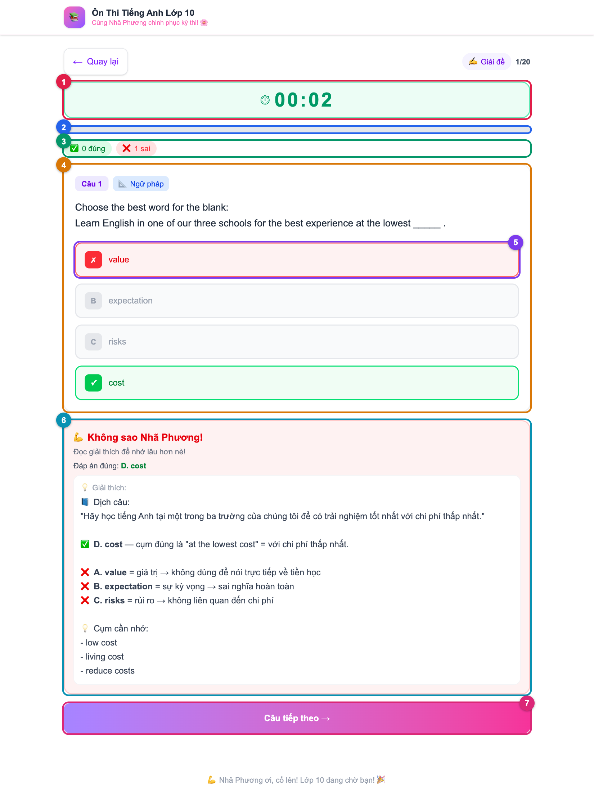
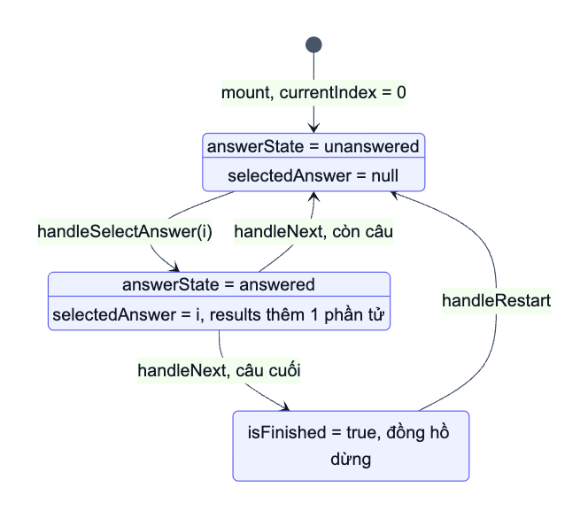
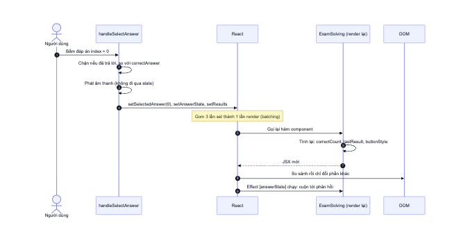
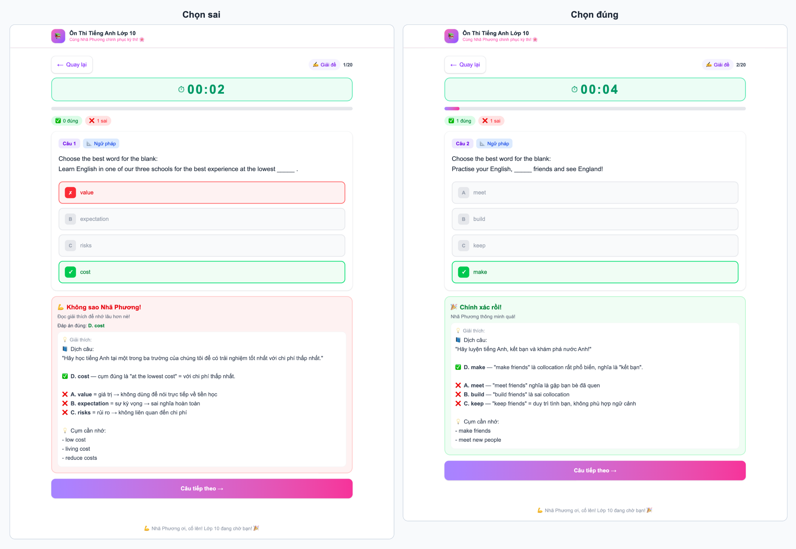
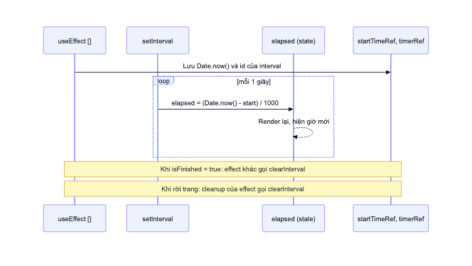
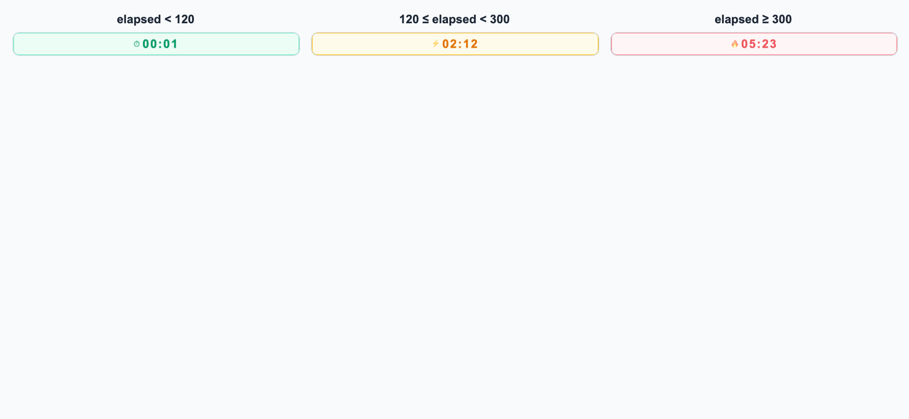
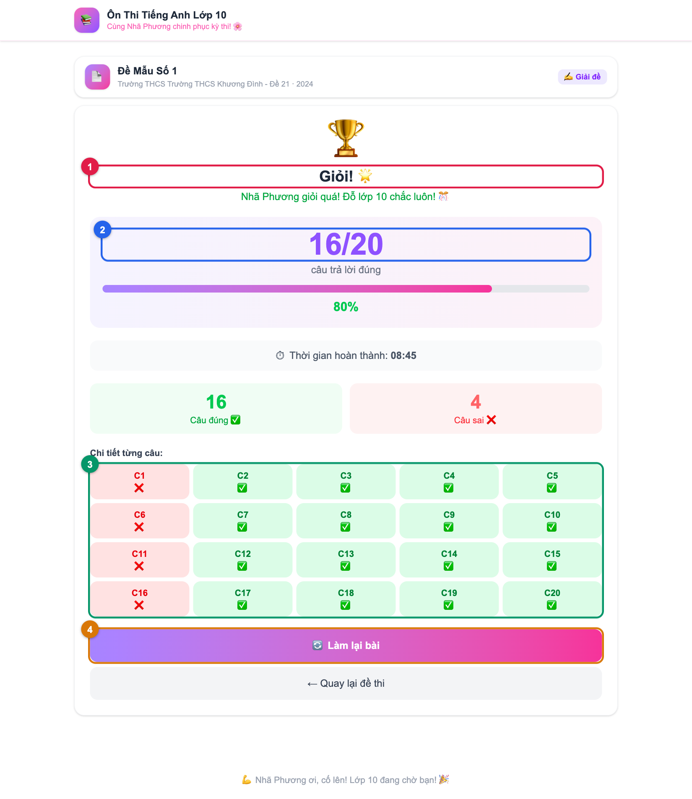

# 07. Phân tích ExamSolving

> **Câu hỏi cốt lõi:** Toàn bộ màn hình làm bài được điều khiển bởi vài biến state như thế nào?
>
> **File nguồn:** [src/components/ExamSolving.tsx](../src/components/ExamSolving.tsx). Hãy mở song song. Đây là file nên đọc kỹ nhất dự án.

## 1. Nguyên lý nền tảng

Toàn bộ file này chỉ thể hiện một công thức của React:

```text
UI = f(state)
```

Không có dòng nào kiểu "tìm nút này rồi đổi màu". Code chỉ làm hai việc: **đổi state**, và **mô tả giao diện ứng với state hiện tại**. React lo phần cập nhật DOM.

Cấu trúc file đi theo thứ tự rất nên học theo:

| Dòng | Nội dung | Vì sao đặt ở đó |
|------|----------|----------------|
| [15-44](../src/components/ExamSolving.tsx#L15-L44) | Hằng số: nhãn, màu, lời động viên | Ngoài component nên không bị tạo lại mỗi lần render |
| [46-76](../src/components/ExamSolving.tsx#L46-L76) | Hàm phụ: `formatTime`, `renderBoldText` | Không cần state nên để ngoài |
| [79-114](../src/components/ExamSolving.tsx#L79-L114) | Hook: state, ref, effect | Luôn gọi theo cùng thứ tự |
| [116-119](../src/components/ExamSolving.tsx#L116-L119) | Giá trị suy ra từ state | Tính lại ở mỗi lần render |
| [121-151](../src/components/ExamSolving.tsx#L121-L151) | Event handler | Nơi state thay đổi |
| [154-255](../src/components/ExamSolving.tsx#L154-L255) | Giao diện kết quả | Trả về sớm khi `isFinished` |
| [257-414](../src/components/ExamSolving.tsx#L257-L414) | Giao diện làm bài | Trường hợp còn lại |

## 2. Năm biến state

```tsx
const [currentIndex, setCurrentIndex] = useState(0);
const [selectedAnswer, setSelectedAnswer] = useState<number | null>(null);
const [answerState, setAnswerState] = useState<AnswerState>('unanswered');
const [results, setResults] = useState<Array<{ correct: boolean; selected: number }>>([]);
const [isFinished, setIsFinished] = useState(false);
```

Thêm `elapsed` cho đồng hồ. Đối chiếu từng biến với giao diện:



| Số | Vùng giao diện | Phụ thuộc vào |
|----|----------------|---------------|
| 1 | Đồng hồ | `elapsed` |
| 2 | Thanh tiến độ | `currentIndex / questions.length` |
| 3 | Đếm đúng/sai | `results` |
| 4 | Thẻ câu hỏi | `exam.questions[currentIndex]` |
| 5 | Màu từng đáp án | `answerState`, `selectedAnswer`, `correctAnswer` |
| 6 | Hộp phản hồi | `answerState`, `results` cuối cùng |
| 7 | Nút tiếp theo | `answerState`, `isLastQuestion` |

## 3. Máy trạng thái

Dù có nhiều biến, màn hình thực chất chỉ ở **một trong ba trạng thái**:



Vẽ được sơ đồ này là bạn đã hiểu màn hình. **Khi gặp component phức tạp, hãy tự vẽ sơ đồ trạng thái trước khi đọc JSX.**

Trạng thái "kết quả" không có URL riêng, chỉ là một lệnh `return` sớm:

```tsx
if (isFinished) {
  return ( /* giao diện kết quả */ );
}
return ( /* giao diện làm bài */ );
```

## 4. Derived state: không lưu thứ tính được

Đây là ý quan trọng nhất của file:

```tsx
const currentQuestion = exam.questions[currentIndex];
const isLastQuestion = currentIndex === exam.questions.length - 1;
const correctCount = results.filter((r) => r.correct).length;
const lastResult = results[results.length - 1];
```

Không biến nào ở trên dùng `useState`. Chúng được **tính lại ở mỗi lần render**.

Nếu lưu `correctCount` vào state, bạn phải nhớ cập nhật nó ở mọi nơi `results` đổi, và quên một chỗ là giao diện hiển thị sai. Đây chính là căn bệnh của trường `totalQuestions` đã gặp ở file 06.

> **Quy tắc:** Trước khi thêm `useState`, hãy hỏi: "Giá trị này có tính được từ state hoặc prop hiện có không?" Nếu có, đừng lưu.

**Đào sâu hơn:** ngay cả `answerState` cũng là thừa. `selectedAnswer` luôn đổi cùng lúc với nó, nên `answerState === 'answered'` tương đương `selectedAnswer !== null`. Đây là một bài tập ở file 11.

## 5. Một lần click diễn ra thế nào?

```tsx
const handleSelectAnswer = (optionIndex: number) => {
  if (answerState !== 'unanswered') return;
  setSelectedAnswer(optionIndex);
  const isCorrect = optionIndex === currentQuestion.correctAnswer;
  if (isCorrect) playCorrectSound(); else playIncorrectSound();
  setAnswerState('answered');
  setResults((prev) => [...prev, { correct: isCorrect, selected: optionIndex }]);
};
```



Những điểm cần hiểu cho chắc:

**Batching.** Có ba lần gọi `set...` nhưng chỉ có **một** lần render. React gom chúng lại, nên không bao giờ xuất hiện trạng thái trung gian trên màn hình.

**State là ảnh chụp.** Sau `setAnswerState('answered')`, biến `answerState` trong hàm vẫn giữ giá trị cũ cho đến lần render sau.

**Cập nhật dạng hàm.** `setResults((prev) => ...)` nhận giá trị mới nhất thay vì giá trị của ảnh chụp. Ở đây mỗi click chỉ cập nhật một lần nên dạng thường cũng chạy đúng, nhưng dạng hàm là thói quen an toàn khi giá trị mới phụ thuộc giá trị cũ.

**Tính bất biến.** `[...prev, x]` tạo mảng mới thay vì `prev.push(x)`. React so sánh bằng tham chiếu, nên nếu sửa trực tiếp mảng cũ thì React có thể không biết có thay đổi.

**Hiệu ứng phụ đúng chỗ.** Âm thanh được phát trong event handler vì nó xảy ra *do một hành động cụ thể*. Không cần `useEffect`.

**Hai lớp bảo vệ.** Dòng `if (answerState !== 'unanswered') return;` và thuộc tính `disabled` cùng ngăn việc trả lời hai lần.

## 6. Render danh sách đáp án

```tsx
{currentQuestion.options.map((option, index) => {
  let buttonStyle = 'bg-gray-50 border-gray-200 ...';
  if (answerState === 'answered') {
    if (index === currentQuestion.correctAnswer) {
      buttonStyle = 'bg-green-50 border-green-400 text-green-700';
    } else if (index === selectedAnswer) {
      buttonStyle = 'bg-red-50 border-red-400 text-red-600';
    } else {
      buttonStyle = 'bg-gray-50 border-gray-200 text-gray-400';
    }
  }
  return <button key={index} onClick={() => handleSelectAnswer(index)} ...>
```

Mỗi đáp án luôn thuộc đúng một trong các trường hợp sau:

| Tình huống | Style |
|------------|-------|
| Chưa trả lời | Xám, có hover |
| Đã trả lời, đây là đáp án đúng | Xanh, dấu ✓ |
| Đã trả lời, đây là đáp án bạn chọn sai | Đỏ, dấu ✗ |
| Đã trả lời, đáp án khác | Xám nhạt |



**Vì sao `onClick={() => handleSelectAnswer(index)}`?** Nếu viết `onClick={handleSelectAnswer(index)}`, hàm sẽ chạy ngay trong lúc render. Ta cần truyền vào một *hàm*, chứ không phải *kết quả của việc gọi hàm*.

## 7. Bài học về `key`: animation không chạy lại

Thẻ câu hỏi có class `animate-slide-up`. Bạn có thể đoán rằng mỗi câu mới sẽ trượt lên. **Thực tế không phải vậy.** Kết quả đo khi theo dõi sự kiện `animationstart`:

| Hành động | Animation chạy |
|-----------|----------------|
| Bấm đáp án | `slideUp` trên hộp phản hồi và nút tiếp theo |
| Bấm "Câu tiếp theo" | **Không có gì** |

**Vì sao?** Khi sang câu mới, thẻ `div` vẫn cùng loại và cùng vị trí trong cây. React chỉ cập nhật nội dung bên trong DOM node cũ. Node không được tạo mới nên CSS animation không chạy lại. Còn hộp phản hồi có animation vì nó bị gỡ khỏi DOM rồi được tạo lại.

**Cách sửa** chỉ cần một prop, và đây là một công dụng rất hay của `key`:

```tsx
<div key={currentQuestion.id} className="... animate-slide-up">
```

`key` thay đổi thì React coi đó là component mới: huỷ node cũ, tạo node mới, và animation chạy lại. **`key` không chỉ dùng cho danh sách, nó còn quyết định "đây có phải cùng một phần tử không".**

## 8. Đồng hồ: `useState`, `useRef` và `useEffect` phối hợp

```tsx
const [elapsed, setElapsed] = useState(0);
const startTimeRef = useRef<number>(0);
const timerRef = useRef<ReturnType<typeof setInterval> | null>(null);

useEffect(() => {
  startTimeRef.current = Date.now();
  timerRef.current = setInterval(() => {
    setElapsed(Math.floor((Date.now() - startTimeRef.current) / 1000));
  }, 1000);
  return () => { if (timerRef.current) clearInterval(timerRef.current); };
}, []);
```



### Vì sao cần cả ba?

| Dữ liệu | Công cụ | Lý do |
|---------|---------|-------|
| Số giây đã qua | `useState` | Thay đổi phải **hiện lên màn hình** |
| Thời điểm bắt đầu | `useRef` | Cần nhớ qua các lần render, nhưng đổi thì không cần render lại |
| ID của interval | `useRef` | Tương tự, chỉ để gọi `clearInterval` |

> **Quy tắc phân biệt:** giá trị xuất hiện trong JSX thì dùng state. Giá trị chỉ dùng cho logic bên trong thì dùng ref.

**Vì sao khởi tạo `startTimeRef` bằng `0` chứ không phải `Date.now()`?** Giá trị thật được gán trong effect, ngay trước khi đồng hồ bắt đầu chạy. Còn `useRef(Date.now())` sẽ gọi một hàm không thuần **trong lúc render**, mỗi lần render ra một kết quả khác nhau. ESLint chặn cách viết đó bằng luật `react-hooks/purity`.

### Vì sao tính từ `Date.now()` thay vì `setElapsed(prev => prev + 1)`?

Đây là một quyết định rất đáng học. `setInterval` **không đảm bảo chạy đúng mỗi giây**: trình duyệt có thể làm chậm nó khi tab ở nền. Nếu đếm bằng cách cộng 1, chuyển tab một lúc thì đồng hồ sẽ chậm hơn thời gian thực. Tính từ mốc bắt đầu thì lần chạy kế tiếp luôn hiện đúng.

### Vì sao phải cleanup?

Nếu không `clearInterval`, interval vẫn tiếp tục chạy sau khi rời trang, vừa tốn tài nguyên vừa gọi state của component đã bị gỡ. Hàm `return` trong effect sẽ chạy khi unmount.

### Đồng hồ dừng và chạy lại thế nào?

- **Dừng:** một effect khác theo dõi `[isFinished]` rồi gọi `clearInterval`.
- **Chạy lại:** `handleRestart` tự tạo interval mới, vì effect với deps `[]` không chạy lại nữa.
- Cleanup vẫn dừng được interval mới, vì nó đọc `timerRef.current` **tại thời điểm cleanup**, không phải lúc effect được tạo. Đây là lợi thế của ref so với biến thường.

### Đổi màu theo thời gian

Đây là một ví dụ của `UI = f(state)`: chỉ cần so sánh `elapsed` khi render, không cần state hay effect nào thêm.



### `useRef` thứ hai: trỏ tới DOM

```tsx
const feedbackRef = useRef<HTMLDivElement>(null);

useEffect(() => {
  if (answerState === 'answered' && feedbackRef.current) {
    setTimeout(() => {
      feedbackRef.current?.scrollIntoView({ behavior: 'smooth', block: 'nearest' });
    }, 50);
  }
}, [answerState]);
```

Việc cuộn trang là thao tác với hệ thống bên ngoài React, nên đặt trong effect là hợp lý. Effect chạy sau khi DOM đã cập nhật, nên lúc này `ref` đã trỏ tới hộp phản hồi.

## 9. Hàm `renderBoldText`

Dữ liệu dùng `**đậm**` và xuống dòng, ví dụ:

```text
✅ **D. cost** — cụm đúng là "at the lowest cost"
```

```tsx
const lines = text.split('\n');
// Mỗi dòng:
const parts = line.split(/(\*\*.*?\*\*)/g);
```

Biểu thức có **nhóm bắt `( )`** nên `split` giữ lại cả phần khớp:

```ts
'**D. cost** — cụm đúng'.split(/(\*\*.*?\*\*)/g)
// ['', '**D. cost**', ' — cụm đúng']
```

Các phần bắt đầu và kết thúc bằng `**` được bọc trong `<strong>`, phần còn lại giữ nguyên.

**Vì sao không dùng `dangerouslySetInnerHTML` cho nhanh?** Vì cách này an toàn với XSS: nội dung luôn được render dưới dạng văn bản, kể cả khi có chứa thẻ `<script>`. Trong dữ liệu hiện tại, 471 trên 485 lời giải thích có dùng in đậm, nên đây là hàm được dùng rất nhiều.

## 10. Màn hình kết quả



| Số | Phần tử | Nguồn |
|----|---------|-------|
| 1 | Xếp loại | `getGrade(percentage)` |
| 2 | Số câu đúng | `correctCount` |
| 3 | Ô từng câu | `results.map(...)` |
| 4 | Nút làm lại | `handleRestart` đặt mọi state về ban đầu |

Toàn bộ màn hình được tính từ `results`, nên hầu như không có state nào dành riêng cho nó.

**Một dữ liệu chưa khai thác:** `results` có lưu `selected`, nhưng không nơi nào đọc nó. Bạn có thể dùng nó để làm tính năng xem lại câu sai, xem file 11.

## 11. Thử ngay

1. Dùng React DevTools chọn `ExamSolving`, quan sát state đổi khi bấm.
2. Thêm `console.log('render')` đầu component rồi chạy bằng `npm run build && npm start`. Bạn sẽ thấy render **mỗi giây** do đồng hồ, và **một lần** cho mỗi click dù có ba lần `set`. Ở `npm run dev`, Strict Mode gọi hàm render hai lần nên số log sẽ gấp đôi.
3. Xoá dòng `return () => ...` của effect đồng hồ. Vào rồi rời trang nhiều lần xem có gì khác, sau đó hoàn tác.
4. Đổi đồng hồ thành `setElapsed((prev) => prev + 1)`, chuyển sang tab khác khoảng 10 phút rồi quay lại so với giờ thực. Trình duyệt thường chỉ giới hạn mạnh timer sau khi tab ẩn vài phút, nên thử quá ngắn có thể chưa thấy lệch. Hoàn tác sau khi thử.
5. Thêm `key={currentQuestion.id}` như mục 7 để thấy animation chạy lại.

## 12. Tự kiểm tra

1. Vẽ lại sơ đồ ba trạng thái mà không nhìn tài liệu.
2. Vì sao `correctCount` không dùng `useState`?
3. Ba lần `set...` trong handler gây ra mấy lần render?
4. Vì sao `startTimeRef` là ref, còn `elapsed` là state?
5. Vì sao câu mới không có animation?
6. Vì sao đồng hồ tính từ `Date.now()`?
7. Vì sao phát âm thanh trong handler thay vì trong `useEffect`?

<details>
<summary>Đáp án</summary>

2. Nó tính được từ `results`. Lưu riêng dễ làm hai nguồn dữ liệu lệch nhau.
3. Một lần, nhờ batching.
4. `elapsed` hiện trên màn hình nên thay đổi phải gây render. `startTimeRef` chỉ dùng trong logic.
5. React tái sử dụng DOM node cũ vì cùng loại và cùng vị trí. Dùng `key` để buộc tạo mới.
6. `setInterval` không chính xác, nhất là khi tab ở nền. Tính từ mốc thời gian thì giá trị luôn đúng.
7. Âm thanh là phản ứng của một hành động cụ thể, không phải việc đồng bộ với state. Đó đúng là vai trò của event handler.

</details>

**Tiếp theo:** [08. Phân tích VocabularyPractice](08-vocabulary-practice.md)
