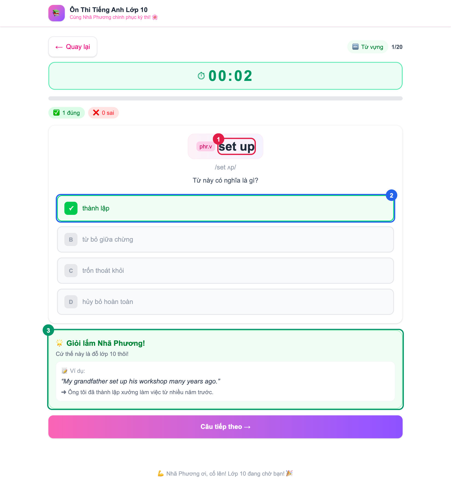
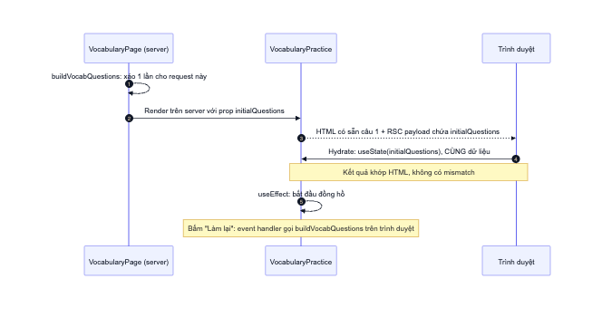
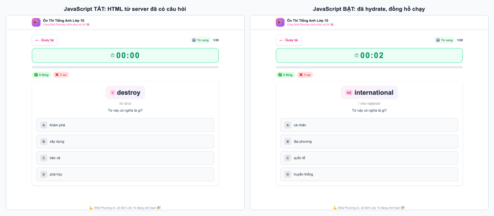

# 08. Phân tích VocabularyPractice

> **Câu hỏi cốt lõi:** Câu hỏi từ vựng phải ngẫu nhiên mỗi lần vào trang, vậy vì sao việc xáo lại được làm trên server mà không làm trong component?
>
> **File nguồn:** [src/components/VocabularyPractice.tsx](../src/components/VocabularyPractice.tsx) và [src/app/exam/[id]/vocabulary/page.tsx](../src/app/exam/[id]/vocabulary/page.tsx). Nên đọc file 05 và 07 trước.

## 1. Khác gì so với ExamSolving?

Phần lớn logic giống hệt `ExamSolving`, nên ta chỉ tập trung vào phần khác biệt.

| | ExamSolving | VocabularyPractice |
|---|---|---|
| **Câu hỏi đến từ** | `exam.questions`, có sẵn trong dữ liệu | Prop `initialQuestions`, **xáo trên server** |
| **Thứ tự** | Cố định | **Ngẫu nhiên** mỗi request |
| **State thêm** | Không | `questions`, để "Làm lại" xáo được bộ mới |
| **`answerState`** | `unanswered`, `answered` | `unanswered`, `correct`, `incorrect` |
| **Vị trí đáp án đúng** | `correctAnswer` trong dữ liệu | `correctIndex`, tính lúc xáo |
| **Chi tiết từng câu ở kết quả** | Có | Không |



1. Từ cần hỏi lấy từ `currentQuestion.word`.
2. Đáp án đúng là `currentQuestion.correctIndex`, không cố định giữa các lần chơi.
3. Phản hồi hiện câu ví dụ thay vì lời giải thích.

## 2. Vấn đề: ngẫu nhiên và SSR không hợp nhau

Cách viết tự nhiên nhất là xáo luôn trong component:

```tsx
const [questions] = useState(() => buildVocabQuestions(exam.vocabulary));
```

Trông có vẻ ổn, nhưng hãy nhớ lại file 05: **Client Component chạy hai lần, một lần trên server và một lần trong trình duyệt.**

```text
Server:      Math.random() → thứ tự A, C, B → HTML hiển thị từ "A"
Trình duyệt: Math.random() → thứ tự B, A, C → React tính ra từ "B"
```

Hydration yêu cầu kết quả render ở trình duyệt phải **khớp** với HTML từ server. Hai bên khác nhau gọi là **hydration mismatch**.

### Thí nghiệm thật

Tôi đã sửa một bản sao của dự án theo cách trên và chạy ở chế độ dev. Trình duyệt báo lỗi:

```text
Hydration failed because the server rendered text didn't match the client.
As a result this tree will be regenerated on the client.
This can happen if a SSR-ed Client Component used:
...
- Variable input such as `Date.now()` or `Math.random()` which changes
  each time it's called.
```

Khi xảy ra mismatch, React phải bỏ HTML của server và dựng lại phía client, tức là mất lợi ích của SSR.

## 3. Lời giải: xáo trên server, truyền xuống qua prop

Ý tưởng chính: **chỉ xáo một lần, ở một nơi, rồi để cả server lẫn trình duyệt dùng chung kết quả đó.**

[Trang từ vựng](../src/app/exam/[id]/vocabulary/page.tsx) là Server Component, nên nó xáo xong mới truyền cho component:

```tsx
export default async function VocabularyPage({ params }: Props) {
  const { id } = await params;
  const exam = getExamById(id);
  if (!exam) notFound();

  const initialQuestions = buildVocabQuestions(exam.vocabulary);

  return <VocabularyPractice key={exam.id} exam={exam} initialQuestions={initialQuestions} />;
}
```

Component chỉ cần dùng prop làm giá trị khởi tạo:

```tsx
const [questions, setQuestions] = useState<VocabQuestion[]>(initialQuestions);
```



**Vì sao cách này không bị mismatch?** Ở bước 3, `initialQuestions` được nhúng vào RSC payload trong HTML. Khi hydrate ở bước 4, trình duyệt đọc **chính dữ liệu đó** thay vì tự xáo lại, nên hai bên render ra kết quả giống hệt nhau.

**Bằng chứng:** tắt JavaScript, HTML từ server đã có sẵn câu hỏi và đáp án:



Hai bên hiện từ khác nhau vì đây là **hai lần tải trang riêng**, và mỗi request được xáo một lần. **Đã đo:** ba lần tải liên tiếp cùng một đề cho ba từ đầu tiên khác nhau là `equipment`, `economic impact`, `communal house`. Kết quả đo không có lỗi hydration ở cả dev lẫn production.

### Ba chi tiết nhỏ nhưng quan trọng

**1. Prop chỉ là giá trị khởi tạo.** `useState(initialQuestions)` chỉ đọc prop ở lần render đầu. Sau đó `questions` là state riêng của component, nên "Làm lại" đổi được bằng `setQuestions`.

**2. "Làm lại" xáo trong event handler.**

```tsx
const handleRestart = () => {
  setQuestions(buildVocabQuestions(exam.vocabulary));
  // ...
};
```

Event handler chỉ chạy ở trình duyệt và không tham gia hydration, nên gọi hàm ngẫu nhiên ở đây là an toàn.

**3. `key={exam.id}`.** Vì prop chỉ được đọc lúc khởi tạo, nếu React dùng lại cùng một instance khi chuyển sang đề khác thì state cũ sẽ còn nguyên. `key` thay đổi buộc React tạo component mới, state được khởi tạo lại từ prop mới. Đây là cùng ý tưởng với bài học `key` ở [file 07, mục 7](07-exam-solving.md#7-bài-học-về-key-animation-không-chạy-lại).

## 4. Nên đặt hàm ngẫu nhiên ở đâu?

Đây là bảng tổng kết nên nhớ, áp dụng cho mọi giá trị khác nhau giữa server và client như `Math.random()`, `Date.now()`, `localStorage`:

| Vị trí gọi | An toàn? | Lý do |
|------------|----------|-------|
| Server Component | Có | Chạy một lần, kết quả gửi xuống qua prop |
| Event handler | Có | Chỉ chạy ở trình duyệt, sau hydration |
| `useEffect` | Được, nhưng có giá | Phải render một lần với giá trị tạm như spinner, sau đó render lại. ESLint cảnh báo bằng luật `react-hooks/set-state-in-effect` |
| Thân Client Component, kể cả `useState(() => ...)` | **Không** | Chạy ở cả server và trình duyệt, gây mismatch |

### Thế `useRef` trong đồng hồ thì sao?

```tsx
const startTimeRef = useRef<number>(0);
```

Hai component đều khởi tạo bằng `0`, còn giá trị thật `Date.now()` được gán trong `useEffect`. Nếu viết `useRef(Date.now())`, ESLint sẽ báo lỗi `react-hooks/purity`: render phải là hàm thuần, cùng đầu vào luôn cho cùng kết quả.

## 5. Cái giá phải trả: dữ liệu bị gửi hai lần

Không có lời giải nào miễn phí. **Kết quả đo** kích thước HTML trên production:

| Trang | Kích thước |
|-------|-----------|
| `/exam/de-mau-01/solving` | 35.314 byte |
| `/exam/de-mau-01/vocabulary` | 44.127 byte |

Trang từ vựng lớn hơn vì danh sách từ vựng có mặt **hai lần** trong payload: một lần trong `exam.vocabulary`, một lần trong `initialQuestions`. Component vẫn cần `exam` để hiện tiêu đề và để xáo lại khi bấm "Làm lại". Với 20 từ thì chênh lệch này không đáng kể, nhưng đây là một bài tập tối ưu hay ở file 11.

## 6. Rules of Hooks trong thực tế

```tsx
const [questions, setQuestions] = useState(initialQuestions);
const [currentIndex, setCurrentIndex] = useState(0);
// ... các hook khác ...

if (isFinished) {
  return <ResultScreen />;   // Return sớm, nằm SAU mọi hook
}
```

**Vì sao mọi hook phải đứng trước `return` sớm?** React nhận biết hook theo **thứ tự gọi**. Nếu đặt một `useState` sau `if (isFinished) return`, số hook được gọi sẽ thay đổi giữa các lần render, và React không còn khớp được state với hook.

**Một cái bẫy về kiểu dữ liệu.** `questions[currentIndex]` có kiểu `VocabQuestion`, nhưng nếu một đề có danh sách từ vựng rỗng thì giá trị thật là `undefined`, và `currentQuestion.word` sẽ làm app crash. TypeScript mặc định không bắt lỗi truy cập chỉ số mảng. Tuỳ chọn `noUncheckedIndexedAccess` trong `tsconfig` sẽ buộc bạn xử lý trường hợp này.

## 7. Strict Mode: effect chạy hai lần

Next.js bật Strict Mode mặc định cho App Router, nhưng **chỉ có tác dụng ở dev**. **Log đo được** khi thêm một effect có log vào component và mở trang ở dev:

```text
PROBE effect mount
PROBE effect cleanup
PROBE effect mount
```

React cố tình **mount, gỡ, rồi mount lại** để phát hiện effect thiếu cleanup. Với effect đồng hồ, điều này không gây hại vì cleanup đã dọn interval đầu tiên. Nếu thiếu cleanup, ở dev sẽ có hai interval chạy song song.

**Đừng tắt Strict Mode khi thấy effect chạy hai lần.** Đó là công cụ tìm lỗi đang làm đúng việc.

## 8. Trùng lặp code

Đoạn tạo câu hỏi đã được gom thành một hàm duy nhất là `buildVocabQuestions` trong [utils.ts](../src/lib/utils.ts), dùng ở cả server lẫn "Làm lại" (xem file 10).

Giữa `VocabularyPractice` và `ExamSolving` vẫn còn nhiều phần giống nhau: đồng hồ, thanh tiến độ, đếm điểm, phản hồi, màn hình kết quả. Hệ quả có thật: lỗi animation ở [file 07, mục 7](07-exam-solving.md#7-bài-học-về-key-animation-không-chạy-lại) xuất hiện ở cả hai file, nên phải sửa hai lần. File 11 có bài tập tách `useTimer` và các component dùng chung.

Tuy vậy, trùng lặp không phải lúc nào cũng xấu: với app nhỏ, hai file độc lập rất dễ đọc. Thông thường, hãy đợi đến khi thấy rõ phần nào thực sự chung rồi mới tách.

## 9. Thử ngay

1. Tắt JavaScript rồi mở trang từ vựng. Câu hỏi vẫn hiện. Xem page source và tìm từ đầu tiên đang hiển thị.
2. Tải lại trang vài lần để thấy thứ tự đổi theo từng request.
3. Làm lại thí nghiệm ở mục 2: đổi `useState(initialQuestions)` thành `useState(() => buildVocabQuestions(exam.vocabulary))`, chạy `npm run dev` rồi đọc lỗi trong Console. Hoàn tác sau khi thử.
4. Thêm `console.log('xáo')` vào `buildVocabQuestions`. Log xuất hiện ở **terminal** khi tải trang, và ở **Console trình duyệt** khi bấm "Làm lại".

## 10. Tự kiểm tra

1. Vì sao không được gọi `Math.random()` trong thân Client Component có SSR?
2. Vì sao xáo trong Server Component thì không bị mismatch?
3. Vì sao "Làm lại" được phép xáo ngay trong component?
4. `useState(initialQuestions)` có cập nhật khi prop thay đổi không? `key={exam.id}` giải quyết vấn đề gì?
5. Vì sao `if (isFinished) return` phải nằm sau mọi hook?
6. Kể ba thứ khác cũng có thể gây hydration mismatch.

<details>
<summary>Đáp án</summary>

1. Server và trình duyệt cho kết quả khác nhau, gây hydration mismatch.
2. Chỉ xáo một lần. Kết quả được gửi xuống qua RSC payload, và trình duyệt dùng lại đúng dữ liệu đó khi hydrate.
3. Code nằm trong event handler, chỉ chạy ở trình duyệt sau hydration.
4. Không, prop chỉ được đọc ở lần render đầu. `key` buộc React tạo component mới khi đổi đề, nên state khởi tạo lại từ prop mới.
5. React nhận biết hook theo thứ tự gọi, nên thứ tự này phải giống nhau ở mọi lần render.
6. `Date.now()`, `localStorage`, nhánh `typeof window`, định dạng ngày theo locale, hoặc lồng thẻ HTML sai.

</details>

**Tiếp theo:** [09. Tailwind và giao diện](09-tailwind-va-giao-dien.md)
