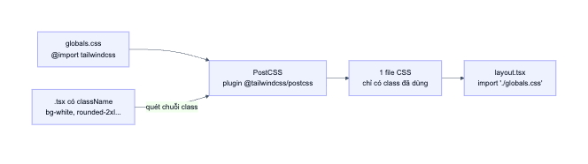
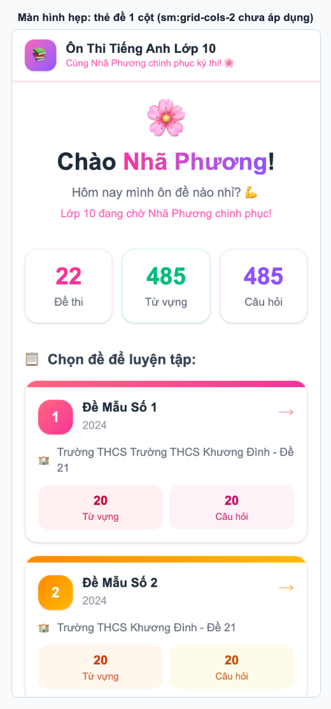
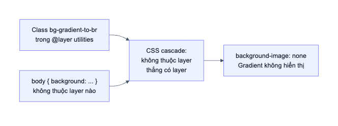
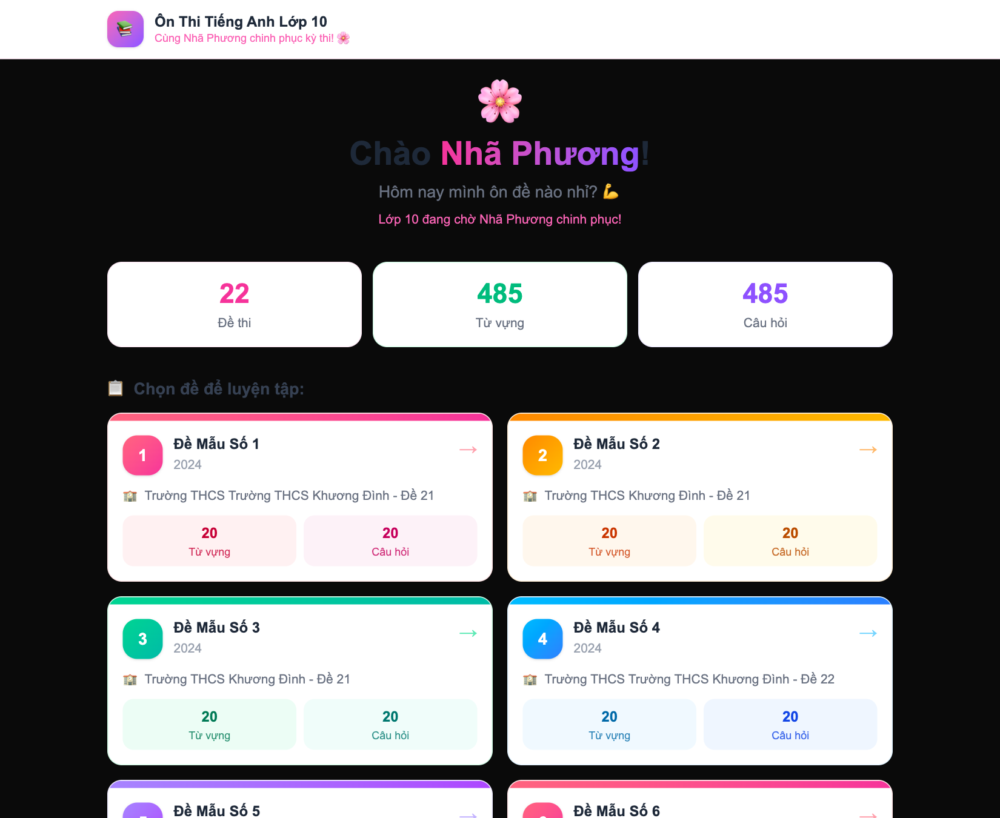

# 09. Tailwind và giao diện

> **Câu hỏi cốt lõi:** Các chuỗi class dài trong JSX trở thành CSS bằng cách nào? Làm sao để đọc chúng nhanh?

## 1. Tailwind là gì?

Thay vì đặt tên class rồi viết CSS riêng, bạn ghép các class nhỏ, mỗi class làm một việc:

```tsx
<div className="bg-white rounded-2xl p-4 text-center shadow-sm border border-pink-100">
```

| Class | CSS tương ứng (khái niệm) |
|-------|---------------------------|
| `bg-white` | `background-color: white` |
| `rounded-2xl` | `border-radius` lớn |
| `p-4` | `padding: 1rem` (mỗi đơn vị bằng 0.25rem) |
| `text-center` | `text-align: center` |
| `shadow-sm` | Đổ bóng nhẹ |
| `border border-pink-100` | Viền 1px màu hồng nhạt |

**Mẹo đọc nhanh:** đừng đọc từng class một. Hãy gom theo nhóm: *bố cục* (`flex`, `grid`), *khoảng cách* (`p-`, `m-`, `gap-`), *kích thước* (`w-`, `h-`), *chữ* (`text-`, `font-`), *màu* (`bg-`, `border-`), *hiệu ứng* (`hover:`, `transition`).

## 2. Từ class đến CSS



Dự án dùng Tailwind v4 nên **không có `tailwind.config.js`**, mọi cấu hình nằm trong CSS. Dòng duy nhất cần có là ở đầu [globals.css](../src/app/globals.css):

```css
@import "tailwindcss";
```

Tailwind **quét mã nguồn dưới dạng văn bản** để tìm tên class, rồi chỉ sinh CSS cho những class đã dùng. Sau khi build, dự án có một file CSS khoảng 37 KB.

### Hệ quả quan trọng: không được ghép tên class động

```tsx
// SAI: Tailwind không thấy chuỗi "bg-rose-50" trong mã nguồn
<div className={`bg-${color}-50`} />

// ĐÚNG: Tên class xuất hiện đầy đủ
const cardThemes = [{ vocabBg: 'bg-rose-50', vocabText: 'text-rose-700' }];
```

Đây là lý do [src/app/page.tsx](../src/app/page.tsx#L13-L62) viết đầy đủ từng tên class cho 5 bộ màu, dù trông có vẻ dài. Đó là cách làm đúng, không phải code thừa.

Với giá trị thực sự động, hãy dùng `style`:

```tsx
<div style={{ width: `${percentage}%` }} />
```

## 3. Các kỹ thuật dùng trong dự án

### 3.1. Responsive: mobile-first

```tsx
<div className="grid gap-4 sm:grid-cols-2">
```

Class không có tiền tố áp dụng cho mọi kích thước. Tiền tố `sm:` chỉ áp dụng **từ 640px trở lên**. Nói cách khác, bạn viết cho điện thoại trước, rồi bổ sung cho màn hình lớn.



**Đã đo:** ở bề ngang 390px, trang không bị tràn ngang.

### 3.2. `hover:` và `group-hover:`

```tsx
<Link className="block group">
  <div className="group-hover:-translate-y-1">
    <span className="group-hover:translate-x-1">→</span>
  </div>
</Link>
```

`group` đánh dấu phần tử cha. Khi di chuột vào cha, các con có `group-hover:` sẽ phản ứng. Toàn bộ hiệu ứng này chỉ là CSS, không có state hay JavaScript nào.

### 3.3. Hàm `cn`: ghép class theo điều kiện

```tsx
<div className={cn(
  'rounded-2xl p-4 mb-4 animate-slide-up border-2',
  lastResult?.correct ? 'bg-green-50 border-green-200' : 'bg-red-50 border-red-200'
)}>
```

`cn` là lớp bọc mỏng quanh `clsx`. Nó bỏ qua các giá trị rỗng như `false`, `null`, `undefined`. Do đó cú pháp `answerState === 'answered' && 'cursor-default'` viết được: khi điều kiện sai, `false` được bỏ qua.

### 3.4. Animation tự viết

Tailwind cho phép thêm class riêng trong [globals.css](../src/app/globals.css#L47-L63):

```css
@layer utilities {
  /* "both" = giữ nguyên trạng thái cuối sau animation, tránh bị invisible trên iOS Safari */
  .animate-slide-up {
    animation: slideUp 0.3s ease-out both;
  }
}
```

- `animate-fade-in`, `animate-slide-up`, `animate-bounce-in` là tự viết.
- `animate-pulse`, dùng khi đồng hồ quá 5 phút, có sẵn trong Tailwind.

### 3.5. `sticky` header

```tsx
<header className="... sticky top-0 z-50">
```

Header cuộn theo trang cho tới khi chạm đỉnh rồi dính lại. `z-50` giữ nó nằm trên nội dung.

## 4. Hai lỗi thật về CSS trong dự án

Đây là phần thú vị nhất của file này. Cả hai lỗi đều không gây báo đỏ ở đâu cả.

### Lỗi 1: nền gradient không bao giờ hiển thị

[layout.tsx](../src/app/layout.tsx#L27) khai báo nền hồng tím:

```tsx
<body className="min-h-screen bg-gradient-to-br from-pink-50 via-white to-violet-50">
```

Nhưng toàn bộ ảnh chụp trong tài liệu đều có nền trắng. **Đo được trong trình duyệt:** `background-image: none`.

**Nguyên nhân** nằm ở [globals.css](../src/app/globals.css#L37-L45):

```css
body {
  background: var(--background);
}
```



Hai sự thật cộng lại gây ra lỗi này:

1. Class của Tailwind nằm trong **`@layer utilities`**. Theo quy tắc **CSS cascade layers**, CSS **không thuộc layer nào luôn thắng** CSS trong layer, bất kể độ đặc hiệu.
2. `background` là thuộc tính viết tắt, nó đặt luôn `background-image` về `none`.

**Đã thử:** xoá khai báo `background` đó trực tiếp trong trình duyệt, gradient hiện ra ngay:


Hãy so với [ảnh trang chủ hiện tại](images/01-trang-chu.png) để thấy sự khác biệt.

### Lỗi 2: dark mode làm hỏng giao diện

```css
@media (prefers-color-scheme: dark) {
  :root { --background: #0a0a0a; --foreground: #ededed; }
}
```

Đoạn này đến từ template mặc định của Next.js. Khi hệ điều hành bật dark mode, nền `body` đổi thành gần đen, nhưng toàn bộ component vẫn viết màu cho nền sáng. **Kết quả đo:** nền `rgb(10, 10, 10)`, và chữ "Chào" hay "Chọn đề để luyện tập" gần như không đọc được.



**Cách sửa đơn giản nhất** là gỡ khai báo `background` và khối `@media` để chỉ có một giao diện sáng. Muốn hỗ trợ dark mode thật thì phải thêm class `dark:` cho từng component.

**Bài học:** khi dùng template có sẵn, hãy đọc và dọn những gì không dùng. Trong file này còn một vết tích nữa: `--font-sans: var(--font-geist-sans)` trỏ tới một font chưa từng được nạp. Trang thực tế dùng `Arial`, đã đo được.

## 5. Thử ngay

1. Mở DevTools, chọn thẻ `<body>`, xem tab Styles. Bạn sẽ thấy `background-image` của Tailwind bị gạch ngang.
2. Bật dark mode: DevTools > `Cmd+Shift+P` > `Emulate CSS prefers-color-scheme: dark`.
3. Dùng chế độ thiết bị di động trong DevTools, kéo rộng dần để thấy đúng lúc lưới chuyển sang 2 cột.
4. Sửa `sm:grid-cols-2` thành `lg:grid-cols-3` xem bố cục đổi ra sao, sau đó hoàn tác.

## 6. Tự kiểm tra

1. `sm:grid-cols-2` nghĩa là gì trên điện thoại 390px?
2. Vì sao không viết được `` `bg-${color}-50` ``?
3. Vì sao class của Tailwind thua `body { background: ... }` dù class thường có độ đặc hiệu cao hơn?
4. `group-hover:` có cần state không?

<details>
<summary>Đáp án</summary>

1. Chưa áp dụng, vì 390px nhỏ hơn 640px, nên lưới có một cột.
2. Tailwind quét mã nguồn dạng văn bản, không chạy code, nên không biết `color` có giá trị gì và không sinh CSS tương ứng.
3. Cascade layer được xét trước độ đặc hiệu. CSS không thuộc layer thắng CSS trong layer.
4. Không, đó hoàn toàn là CSS.

</details>

**Tiếp theo:** [10. Tiện ích và âm thanh](10-tien-ich-va-am-thanh.md)
