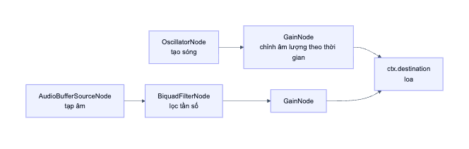

# 10. Tiện ích và âm thanh

> **Câu hỏi cốt lõi:** Vì sao tách một số logic ra khỏi component? Làm sao tạo âm thanh mà không cần file nhạc?

## 1. `utils.ts`: hàm thuần

[src/lib/utils.ts](../src/lib/utils.ts) chỉ có các hàm nhỏ, độc lập với React.

**Hàm thuần (pure function)** là hàm mà cùng đầu vào luôn cho cùng đầu ra và không tác động ra bên ngoài. Loại hàm này dễ hiểu và rất dễ test, vì không cần trình duyệt hay React.

| Hàm | Thuần? | Dùng ở đâu |
|-----|--------|-----------|
| `cn` | Có | Khắp các component |
| `calculatePercentage` | Có | Màn hình kết quả |
| `getGrade` | Có | Màn hình kết quả |
| `shuffleArray` | **Không**, vì dùng `Math.random` | Tạo câu hỏi từ vựng |
| `createVocabMultipleChoice` | **Không**, vì gọi `shuffleArray` | Tạo câu hỏi từ vựng |

Hai hàm cuối chính là thứ gây ra vấn đề hydration ở file 08.

### 1.1. `shuffleArray`: thuật toán Fisher-Yates

```ts
export function shuffleArray<T>(array: T[]): T[] {
  const arr = [...array];                                   // (1)
  for (let i = arr.length - 1; i > 0; i--) {
    const j = Math.floor(Math.random() * (i + 1));          // (2)
    [arr[i], arr[j]] = [arr[j], arr[i]];                    // (3)
  }
  return arr;
}
```

**Minh hoạ với `[A, B, C, D]`:**

| Bước | `i` | `j` ngẫu nhiên | Sau khi đổi chỗ | Đã cố định |
|------|-----|----------------|-----------------|-----------|
| 1 | 3 | 1 | `[A, D, C, B]` | B |
| 2 | 2 | 0 | `[C, D, A, B]` | A, B |
| 3 | 1 | 1 | `[C, D, A, B]` | D, A, B |

Mỗi bước chọn ngẫu nhiên một phần tử trong đoạn chưa cố định rồi đưa về cuối đoạn.

Ba điểm đáng học trong đoạn code:

1. **`[...array]` tạo bản sao.** Nếu không, hàm sẽ xáo luôn mảng gốc `exam.vocabulary` đang là prop. Prop không được phép bị sửa.
2. **`i + 1` để `j` có thể bằng `i`.** Một phần tử được phép giữ nguyên vị trí, đây là điều kiện để phân bố đều.
3. **Destructuring** giúp đổi chỗ không cần biến tạm.

**Vì sao không dùng cách ngắn hơn `arr.sort(() => Math.random() - 0.5)`?** Vì `sort` cần một hàm so sánh nhất quán. Dùng ngẫu nhiên như vậy sẽ cho phân bố không đều: một số hoán vị xuất hiện nhiều hơn hẳn.

**Generic `<T>`:** hàm hoạt động với mảng kiểu bất kỳ, và kiểu được giữ nguyên. Truyền `VocabularyWord[]` vào thì nhận về `VocabularyWord[]`, không bị mất thông tin như khi dùng `any`.

### 1.2. `createVocabMultipleChoice`: tính đáp án đúng

```ts
export function createVocabMultipleChoice(
  word: { definition: string; wrongOptions: string[] },
) {
  const options = shuffleArray([word.definition, ...word.wrongOptions]);
  const correctIndex = options.indexOf(word.definition);
  return { options, correctIndex };
}
```

Trong dữ liệu, đáp án đúng được lưu theo nội dung. Sau khi xáo, hàm tìm lại vị trí bằng `indexOf`. `indexOf` trả về vị trí đầu tiên khớp, nên cách này đúng khi các đáp án không trùng nhau, và kết quả kiểm tra ở file 06 cho thấy dữ liệu đáp ứng điều đó.

**Kiểu tham số chỉ đòi đúng thứ cần dùng** là `{ definition, wrongOptions }`, không đòi cả `VocabularyWord`. TypeScript dùng **structural typing**: object nào có đủ các trường yêu cầu đều được chấp nhận. Hàm vì thế dễ test hơn, vì không phải tạo cả object từ vựng đầy đủ.

### 1.3. `calculatePercentage` và `getGrade`

```ts
if (total === 0) return 0;        // Tránh chia cho 0
return Math.round((correct / total) * 100);
```

```ts
if (percentage >= 90) return { label: 'Xuất sắc! 🏆', color: 'text-yellow-500' };
if (percentage >= 80) return { label: 'Giỏi! 🌟', color: 'text-green-500' };
// ...
```

Viết các `if` có `return` theo thứ tự giảm dần giúp không cần `else`. Nên nhớ quy tắc này khi đọc code: đến `>= 80`, ta biết chắc giá trị nhỏ hơn 90.

### 1.4. `cn`

```ts
export function cn(...inputs: ClassValue[]) {
  return clsx(inputs);
}
```

Hiện tại `cn` chỉ gọi lại `clsx`. Lợi ích của lớp bọc này là về sau có thể đổi cách xử lý ở một chỗ. Một số dự án thêm `tailwind-merge` vào đây để giải quyết xung đột class như `p-2 p-4`.

## 2. `sound.ts`: tạo âm thanh bằng code

[src/lib/sound.ts](../src/lib/sound.ts) không dùng file MP3 nào. Âm thanh được **tổng hợp ngay trong trình duyệt** bằng Web Audio API. Lợi ích: không tốn dung lượng tải, phát tức thì.

Bạn không cần nhớ hết các thông số. Hãy nắm mô hình và những quyết định thiết kế.

### 2.1. Mô hình: một đồ thị các nút

Tưởng tượng các thiết bị âm thanh được nối dây với nhau. Tín hiệu chảy từ nguồn tới loa:



| Nút | Vai trò | Hình dung |
|-----|---------|-----------|
| `OscillatorNode` | Tạo sóng ở một tần số | Một nốt nhạc |
| `GainNode` | Điều chỉnh âm lượng | Núm volume |
| `BiquadFilterNode` | Lọc bớt tần số | Núm chỉnh âm sắc |
| `AudioBufferSourceNode` | Phát dữ liệu mẫu | Ở đây dùng cho tạp âm |
| `destination` | Đầu ra | Loa |

### 2.2. Âm thanh đúng: bốn nốt đi lên

```ts
const notes = [523.25, 659.25, 783.99, 1046.5]; // C5 E5 G5 C6

notes.forEach((freq, i) => {
  const delay = i * 0.1;                        // Mỗi nốt trễ thêm 0.1 giây
  const osc = ctx.createOscillator();
  const gain = ctx.createGain();
  osc.connect(gain);
  gain.connect(ctx.destination);
  osc.frequency.value = freq;
  gain.gain.setValueAtTime(0, t + delay);
  gain.gain.linearRampToValueAtTime(0.3, t + delay + 0.018);       // Tăng rất nhanh
  gain.gain.exponentialRampToValueAtTime(0.001, t + delay + 0.38); // Giảm dần
  osc.start(t + delay);
  osc.stop(t + delay + 0.42);
});
```

Những điều đáng chú ý:

- **Lập lịch theo đồng hồ âm thanh.** `ctx.currentTime` chính xác hơn `setTimeout`, và tất cả nốt được lên lịch ngay từ đầu.
- **Về `0.001` thay vì `0`.** `exponentialRamp` không thể đi tới đúng 0, vì phép tính dạng hàm mũ không xác định ở đó.
- **Mỗi lần phát tạo oscillator mới.** Một oscillator chỉ `start` được một lần. Nút được tạo cho từng lần dùng, đó là cách dùng bình thường của API này.

### 2.3. Âm thanh sai: ba lớp chồng nhau

| Lớp | Tạo ra | Cảm nhận |
|-----|--------|----------|
| Sub-bass | Sóng sine trượt từ 100 xuống 38 Hz | Tiếng "thụp" |
| Tạp âm | Số ngẫu nhiên qua bộ lọc bandpass | Tiếng "xoẹt" ngắn |
| Hai sóng sawtooth lệch ±12 cents | Trượt xuống qua bộ lọc lowpass | Tiếng "waaah" dày |

Dấu ngoặc `{ }` ở mỗi lớp tạo block scope, giúp dùng lại tên biến như `osc`, `gain` mà không xung đột.

### 2.4. Vì sao `audioCtx` là biến cấp module?

```ts
let audioCtx: AudioContext | null = null;

function getAudioContext(): AudioContext | null {
  if (typeof window === 'undefined') return null;
  try {
    if (!audioCtx) {
      const AudioCtx = window.AudioContext || (window as any).webkitAudioContext;
      audioCtx = new AudioCtx();
    }
    if (audioCtx.state === 'suspended') audioCtx.resume();
    return audioCtx;
  } catch {
    return null;
  }
}
```

Từng quyết định đều có lý do:

| Đoạn code | Lý do |
|-----------|-------|
| Biến cấp module | Dùng một `AudioContext` duy nhất. Đây không phải state vì giao diện không phụ thuộc vào nó |
| Khởi tạo lười (`if (!audioCtx)`) | Chỉ tạo khi cần, tức là khi người dùng đã tương tác |
| `resume()` | Trình duyệt chặn tự phát âm thanh và có thể để context ở trạng thái `suspended` cho đến khi có thao tác của người dùng |
| `webkitAudioContext` | Tương thích với Safari đời cũ |
| `try/catch` trả về `null` | Âm thanh chỉ là phần phụ. Lỗi âm thanh không được làm hỏng việc làm bài |

Mục cuối là một nguyên tắc thiết kế hay: **tính năng phụ thất bại thì app chính vẫn chạy.**

## 3. Thử ngay

1. Mở Console trên trang bất kỳ, dán `shuffleArray` rồi gọi nhiều lần để xem kết quả. Thử kiểm tra mảng gốc có đổi không.
2. Trong `sound.ts`, đổi `osc.type = 'sine'` thành `'square'`, bấm một đáp án đúng rồi so sánh âm thanh. Hoàn tác sau khi thử.
3. Đổi `delay = i * 0.1` thành `i * 0.3`, nghe nhịp thay đổi.
4. Đổi thứ tự mảng `notes` để có giai điệu đi xuống.

## 4. Tự kiểm tra

1. Vì sao `shuffleArray` không phải hàm thuần?
2. Điều gì xảy ra nếu bỏ `[...array]` trong `shuffleArray`?
3. Vì sao `audioCtx` không phải `useState`?
4. Vì sao âm lượng giảm về `0.001` thay vì `0`?
5. Nếu tạo `AudioContext` thất bại, người dùng còn làm bài được không?

<details>
<summary>Đáp án</summary>

1. Cùng đầu vào cho ra đầu ra khác nhau do dùng `Math.random`.
2. Hàm sẽ sửa trực tiếp mảng đầu vào, tức là sửa prop `exam.vocabulary`.
3. Giao diện không phụ thuộc vào nó, và nhiều component có thể dùng chung một context.
4. `exponentialRampToValueAtTime` không thể đi tới đúng 0.
5. Được. `getAudioContext` trả về `null`, các hàm phát âm thanh sẽ thoát sớm.

</details>

**Tiếp theo:** [11. Đánh giá và bài tập](11-danh-gia-va-bai-tap.md)
